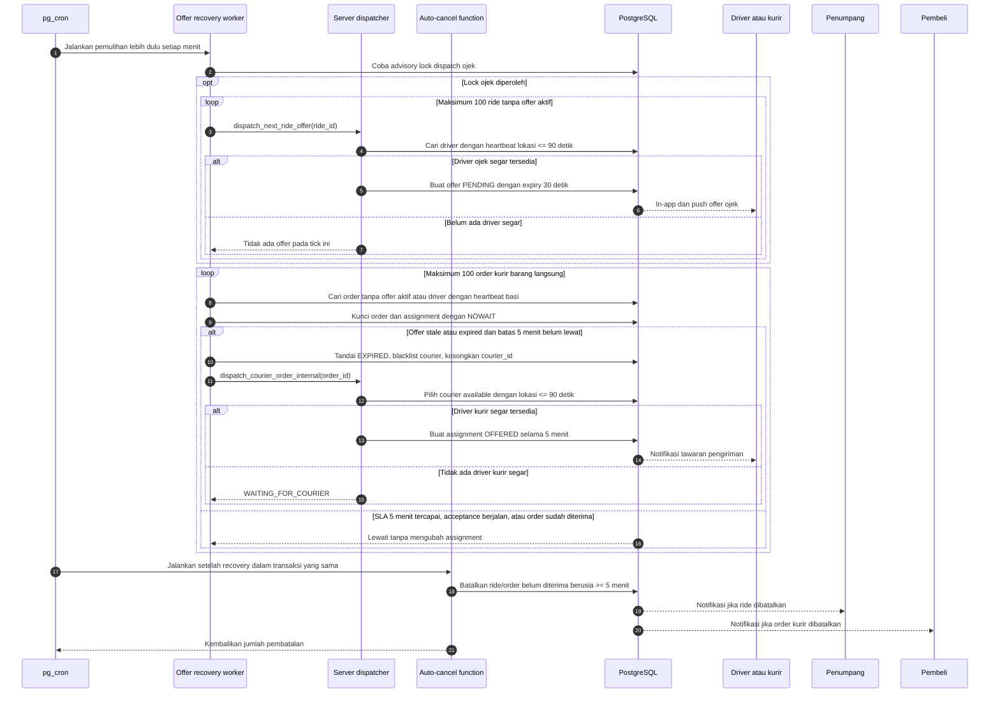

# API: Pembatalan Otomatis Pesanan Ojek dan Kurir Barang

**Status:** internal backend API
**Fungsi database:** `public.auto_cancel_unanswered_transport_orders()`
**Migration:** `20260929140000_auto_cancel_unanswered_transport_orders.sql`, `20260929150000_transport_connection_drop_offer_recovery.sql`
**SLA:** 5 menit tanpa respons driver/kurir; scheduler berjalan setiap menit.

## Ringkasan

Fungsi ini menutup permintaan ojek dan pesanan kurir barang langsung yang belum diterima setelah melewati batas respons lima menit. Worker pemulihan juga mendeteksi driver yang heartbeat lokasinya basi, menutup offer lama, dan mencoba driver lain sebelum batas pembatalan tercapai. Proses berjalan di server melalui `pg_cron`, sehingga tidak bergantung pada halaman pembeli atau aplikasi driver tetap terbuka.

Fungsi ini adalah **maintenance RPC internal**, bukan endpoint publik untuk aplikasi browser. Operasi normal dilakukan oleh job terjadwal. Pemanggilan manual hanya untuk pemeriksaan atau operasi backend yang berwenang.

## Kontrak fungsi

```sql
public.auto_cancel_unanswered_transport_orders()
RETURNS integer
```

| Properti | Nilai |
|---|---|
| Parameter | Tidak ada |
| Hasil | Bilangan bulat: jumlah ride/order yang berhasil dibatalkan pada pemanggilan ini |
| Hasil `0` | Tidak ada record yang memenuhi syarat, atau record yang sedang dikunci proses lain dilewati |
| Batch maksimum | Hingga 100 ride dan 100 order kurir langsung per pemanggilan |
| Hak execute | `service_role`; akses `PUBLIC`, `anon`, dan `authenticated` dicabut |
| Keamanan fungsi | `SECURITY DEFINER`, `search_path = public` |
| Idempotensi | Pemanggilan ulang tidak membatalkan ulang record terminal atau membuat histori order duplikat |

### Aturan kelayakan

| Layanan | Syarat semua harus terpenuhi | Status hasil |
|---|---|---|
| Ojek penumpang | `ride_requests.status = 'SEARCHING'`, `driver_id IS NULL`, dan `created_at` sudah berumur sekurangnya 5 menit | `CANCELLED` |
| Kurir barang langsung | `orders.service_type = 'COURIER_DELIVERY'`, `status = 'ASSIGNED'`, belum ada assignment berstatus `ACCEPTED`, `scheduled_pickup = false`, usia order sekurangnya 5 menit. Worker pemulihan lebih dulu melepas offer yang belum diterima dan mengosongkan `courier_id`. | `CANCELED` |

Order marketplace/toko tidak diproses oleh fungsi ini. Booking dengan pickup terjadwal dikecualikan dari SLA ini. Ride/order yang sudah diterima driver atau kurir tidak dibatalkan.

> Karena job berjalan per menit, order dibatalkan pada tick pertama setelah usia 5 menit—umumnya antara 5 dan 6 menit setelah dibuat, bukan tepat pada detik ke-300.

## Penanganan koneksi driver terputus

- Aplikasi driver menulis checkpoint lokasi ke `couriers.last_location_update` setiap 30 detik. Server menganggap driver siap ditawari pekerjaan hanya jika lokasi dan status availability valid serta heartbeat berumur paling lama 90 detik.
- Dispatch awal kurir barang langsung tidak lagi memilih driver dengan heartbeat basi. Jika offer sudah terlanjur dibuat lalu koneksi/heartbeat driver terputus, worker mengubah assignment `OFFERED` menjadi `EXPIRED`, mencatat alasan, menambahkan driver ke `courier_rejected_ids`, mengosongkan pointer `orders.courier_id`, lalu mencoba driver terdekat lain yang masih segar.
- Offer ojek yang kedaluwarsa juga dimajukan ke driver berikutnya oleh worker server-side. Sebelumnya, pemrosesan offer tersebut bergantung pada sesi driver aktif.
- Jika tidak ada driver segar, order kurir barang tetap `ASSIGNED` tanpa courier dan dicoba lagi pada tick berikutnya. Jika masih belum ada yang menerima lima menit sejak order dibuat, fungsi auto-cancel tetap membatalkannya. Retry dijalankan sebelum auto-cancel pada tick yang sama.
- Jika hanya kanal realtime terputus tetapi koneksi API/GPS masih berjalan, polling offer dan refresh saat realtime tersambung kembali tetap memungkinkan driver mengambil tawaran. Fallback heartbeat berlaku saat pembaruan lokasi memang berhenti.

## Sequence Diagram



Jika penguncian menemukan acceptance/dispatch sedang berlangsung, worker melewati record tersebut alih-alih menunggu atau membatalkan secara spekulatif. Pemanggilan cron berikutnya akan memeriksanya kembali.

## Efek samping

### Ojek

Untuk ride yang memenuhi syarat, fungsi:

1. Mengubah offer `PENDING` menjadi `EXPIRED` dan mengisi `responded_at` bila belum ada.
2. Mengubah ride menjadi `CANCELLED`, mengisi `cancelled_at`, `updated_at`, dan `cancellation_reason` dengan `Tidak ada driver yang merespons dalam 5 menit.`
3. Mengirim notifikasi in-app kepada penumpang dengan tautan `/ride/{ride_id}`.

Fungsi juga membersihkan offer `PENDING` untuk ride yang sudah tidak `SEARCHING` atau sudah memiliki `driver_id`.

### Kurir barang langsung

Untuk order yang memenuhi syarat, fungsi:

1. Mengubah order menjadi `CANCELED` dan mengisi `cancelled_at`, `status_updated_at`, `updated_at`, alasan pembatalan, serta `cancellation_type = 'SYSTEM'`. `cancelled_by` tetap `NULL` karena tidak ada pengguna yang melakukan pembatalan.
2. Mengubah assignment berstatus `OFFERED` menjadi `CANCELED`, mengisi `responded_at` dan `rejection_reason`.
3. Menambahkan baris `order_status_history` dari `ASSIGNED` ke `CANCELED` dengan `actor_id = NULL`.
4. Mengirim notifikasi in-app kepada pembeli dengan tautan `/orders/{order_id}/tracking`.

Kegagalan pengiriman notifikasi menghasilkan `WARNING`, tetapi tidak membatalkan transaksi perubahan status.

## Cara pemanggilan

### Cara normal: `pg_cron`

Migration menjadwalkan job berikut secara otomatis. Jika job dengan nama yang sama sudah ada, migration menghapus jadwal lama lalu mendaftarkan ulang jadwal satu menit.

```text
job name: auto-cancel-unanswered-transport-orders
schedule: * * * * *
command:  DO $transport_offer_timeout_pipeline$
          BEGIN
            PERFORM public.process_unresponsive_transport_offers();
            PERFORM public.auto_cancel_unanswered_transport_orders();
          END
          $transport_offer_timeout_pipeline$;
```

Tidak perlu memanggil fungsi dari UI atau dari setiap sesi driver.

### Pemanggilan manual lewat SQL

Gunakan SQL Editor atau koneksi database backend dengan role yang berwenang:

```sql
SELECT public.auto_cancel_unanswered_transport_orders();
```

Contoh hasil:

```text
 auto_cancel_unanswered_transport_orders
------------------------------------------
                                        2
```

Nilai `2` berarti dua record berhasil dibatalkan pada run itu. Jalankan hanya jika perlu; job cron tetap menjadi mekanisme normal.

### Pemanggilan manual lewat Supabase RPC (backend saja)

PostgREST menyediakan fungsi tanpa argumen di endpoint RPC:

```http
POST /rest/v1/rpc/auto_cancel_unanswered_transport_orders
apikey: <SUPABASE_SERVICE_ROLE_KEY>
Authorization: Bearer <SUPABASE_SERVICE_ROLE_KEY>
Content-Type: application/json

{}
```

Contoh `curl` dari lingkungan server terpercaya:

```bash
curl --fail-with-body --request POST \
  "$SUPABASE_URL/rest/v1/rpc/auto_cancel_unanswered_transport_orders" \
  --header "apikey: $SUPABASE_SERVICE_ROLE_KEY" \
  --header "Authorization: Bearer $SUPABASE_SERVICE_ROLE_KEY" \
  --header "Content-Type: application/json" \
  --data '{}'
```

Respons sukses adalah bilangan bulat JSON, misalnya:

```json
2
```

**Jangan** menaruh service-role key di frontend, aplikasi mobile, repositori, log, atau permintaan dari pengguna. Jangan memberikan akses execute fungsi ini kepada `authenticated` untuk penggunaan aplikasi biasa. Pemanggilan manual tidak perlu untuk operasi normal karena `pg_cron` sudah menjalankannya.

## Konkurensi dan retry

- Pemrosesan ride mencoba advisory lock yang sama dengan jalur dispatch/accept ride. Jika lock tidak tersedia, bagian ride dilewati pada run itu; pemrosesan order kurir tetap dapat berjalan.
- Pemrosesan order kurir menggunakan row lock `NOWAIT`. Jika acceptance atau dispatch sedang memegang lock, fungsi melewati order tersebut dan cron mencoba lagi pada menit berikutnya.
- Kondisi status diperiksa kembali setelah lock diambil. Acceptance yang sudah terjadi tidak diubah menjadi pembatalan timeout.
- Pemrosesan dibatasi 100 ride dan 100 order kurir per run untuk membatasi beban. Record yang tertinggal diproses oleh run selanjutnya.
- Kegagalan notifikasi dicatat sebagai warning dan tidak menggagalkan pembatalan yang sudah dicatat.

## Monitoring

Periksa job terjadwal:

```sql
SELECT jobid, jobname, schedule, command, active
FROM cron.job
WHERE jobname = 'auto-cancel-unanswered-transport-orders';
```

Periksa hasil eksekusi terbaru:

```sql
SELECT start_time, end_time, status, return_message
FROM cron.job_run_details
WHERE jobid = (
  SELECT jobid
  FROM cron.job
  WHERE jobname = 'auto-cancel-unanswered-transport-orders'
  ORDER BY jobid DESC
  LIMIT 1
)
ORDER BY start_time DESC
LIMIT 20;
```

Untuk memeriksa apakah kandidat timeout masih tertinggal:

```sql
SELECT id, status, created_at, service_type, courier_id, scheduled_pickup
FROM public.orders
WHERE service_type = 'COURIER_DELIVERY'
  AND status = 'ASSIGNED'
  AND courier_id IS NULL
  AND COALESCE(scheduled_pickup, false) = false
  AND created_at <= now() - interval '5 minutes'
ORDER BY created_at;
```

Query kandidat di atas hanya untuk pemeriksaan; jangan mengubah status langsung dengan SQL ad hoc. Gunakan fungsi terjadwal agar offer, histori, notifikasi, dan proteksi konkurensi ikut diproses.

## Kode respons dan kegagalan

- `200` pada REST RPC: pemanggilan berhasil; body berupa jumlah record yang dibatalkan, termasuk `0` jika tidak ada kandidat.
- `401` / `403`: kredensial tidak ada atau role tidak memiliki hak execute. Fungsi memang tidak dapat dipanggil oleh `anon` atau `authenticated`.
- Kegagalan database pada pemrosesan inti dapat menggagalkan pemanggilan dan terlihat pada `cron.job_run_details`; jadwal berikutnya mencoba kembali selama record tetap memenuhi syarat.
- Kegagalan `send_notification` saja tidak menggagalkan pembatalan inti; detailnya tercatat sebagai warning pada log PostgreSQL.
