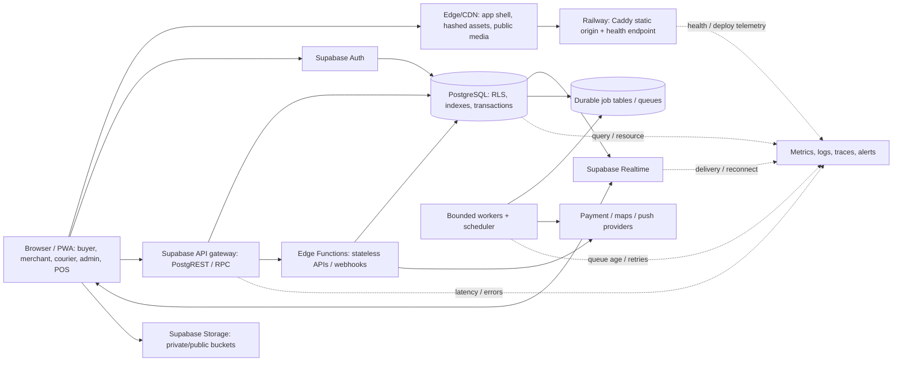

# Rancangan Kesiapan Skala SaDesa — 1.000+ Pengguna

**Status:** rancangan target dan gate verifikasi; bukan bukti kapasitas layanan saat ini.
**Cakupan:** arsitektur runtime, data/API, realtime, pekerjaan asinkron, observability, uji beban, dan rollout.
**Basis:** inspeksi repository pada 16 Oktober 2026. Kapasitas/quota project Supabase dan Railway aktual belum diverifikasi.

## Ringkasan keputusan

Pertahankan pola **frontend statis + backend managed Supabase** sebagai arsitektur awal. Jangan memperkenalkan microservice atau memindahkan database sebelum hasil load test menunjukkan bottleneck yang terukur. Siapkan lapisan-lapisan berikut agar dapat diuji dan dinaikkan kapasitasnya secara terpisah:

1. aset frontend/CDN;
2. Supabase Auth dan API (PostgREST/RPC/Edge Functions);
3. PostgreSQL dengan RLS, indeks, paginasi, dan operasi transaksional;
4. Realtime dengan subscription terbatas dan backfill dari database;
5. antrean/job asinkron dengan retry idempoten;
6. dashboard/alert dan playbook operasional.

**Kesimpulan kesiapan saat ini:** arsitektur teknisnya layak untuk diskalakan secara inkremental, tetapi target 1.000 pengguna bersamaan berstatus **belum terbukti** sampai pengujian staging lintas role selesai pada konfigurasi kapasitas yang benar-benar akan dipakai.

## Definisi beban dan asumsi

“1.000 pengguna” perlu dibedakan menjadi:

- 1.000 akun terdaftar;
- 1.000 pengguna aktif dalam sehari;
- 1.000 sesi browser/PWA tersambung pada waktu yang sama;
- 1.000 pengguna serentak menjalankan transaksi/realtime intensif.

Rancangan ini memakai **1.000 sesi terautentikasi tersambung bersamaan** sebagai sasaran uji utama. Itu bukan berarti 1.000 query berat dilakukan serentak setiap detik. Jalankan workload idle, normal, burst, serta aktivitas khusus (checkout, POS, chat, lokasi kurir) secara terpisah dan gabungan. Model aksi dan proporsi role berikut adalah hipotesis uji yang harus dikalibrasi dari telemetry pilot, bukan asumsi produk yang sudah terukur.

## Arsitektur target

### Jalur request

1. Browser/PWA mengunduh shell dan chunk statis dari edge/CDN atau static origin. Aset ber-hash boleh cache lama; HTML dan service worker harus cepat memperbarui versi aplikasi.
2. Client memakai publishable key dan sesi Supabase Auth. Semua akses browser ke data tetap dibatasi RLS; key publik bukan mekanisme otorisasi.
3. Query biasa menuju API Supabase dengan filter, limit/cursor, serta indeks yang sesuai. Operasi kritis uang, stok, checkout, acceptance, dan idempotensi tetap dilakukan server-side dalam RPC/transaksi.
4. Event realtime memberi notifikasi perubahan; PostgreSQL tetap sumber kebenaran. Saat reconnect, client menyelaraskan ulang state dengan query ber-batas, bukan mengandalkan event yang mungkin terlewat.
5. Pekerjaan yang tidak perlu menahan respons pengguna (push, webhook follow-up, ekspor, rekonsiliasi, cleanup) berjalan melalui queue/job durable dengan worker yang dibatasi concurrency-nya.

## Keputusan desain untuk skala

### 1. Frontend dan edge delivery

- Pertahankan React/Vite dan chunk route lazy-loaded.
- Letakkan aset immutable di edge/CDN bila konfigurasi hosting mendukung; cache asset ber-hash, tetapi revalidate HTML, manifest dan service worker.
- Frontend statis relatif mudah direplikasi; menaikkan jumlah container web **tidak otomatis** meningkatkan kapasitas database, API, atau realtime.
- Pantau bandwidth, ukuran chunk, cache hit, cold load dan error release. Pertahankan `/health` untuk status origin, namun jangan menganggapnya sebagai uji kesiapan Supabase end-to-end.

### 2. API, identitas, dan transaksi

- Tidak perlu menambah server API Node hanya untuk proxy Supabase. Tambahkan backend perantara bila ada kebutuhan yang terbukti: rahasia server-side, orchestration, rate limit lintas endpoint, atau workload CPU panjang.
- Gunakan Edge Functions untuk endpoint stateless singkat dan integrasi; batasi waktu eksekusi, ukuran payload, concurrency eksternal dan retry.
- Semua transaksi sensitif harus server-authoritative, atomik dan idempoten. Terapkan rate limit server-side pada operasi yang dapat disalahgunakan.
- Jangan membuat query browser yang memuat semua histori lalu memfilter di client. Gunakan cursor pagination deterministik, selective columns, indeks yang mendukung filter+sort, dan summary/RPC untuk agregat mahal.
- Periksa query plan (`EXPLAIN ANALYZE`) pada fixture realistis sebelum menambah indeks; ukur write amplification/storage setelah indeks ditambahkan.

### 3. PostgreSQL dan koneksi

- Database adalah dependency bersama yang paling mungkin membatasi sistem sebelum static frontend.
- Browser harus mengakses PostgREST/RPC melalui gateway Supabase; jangan membuka koneksi PostgreSQL langsung dari browser.
- Untuk worker/backend yang membutuhkan koneksi PostgreSQL langsung, gunakan mode connection pooling yang direkomendasikan provider untuk pola transaksi tersebut. Konfirmasi parameter pool dan limit sesuai project/region yang aktif; jangan menanam angka quota yang tidak diverifikasi di dokumen ini.
- Batasi concurrency worker dan request berat agar antrean memberi backpressure, bukan membuka koneksi tanpa batas.
- Tinjau indeks, ukuran tabel, bloat, vacuum/analyze, query lambat, lock wait, transaksi panjang, dan koneksi aktif dari dashboard/telemetry provider.
- Gunakan keyset pagination untuk tabel besar. Offset pagination hanya untuk dataset kecil/terbatas.

### 4. Realtime

- Satu subscription hanya untuk konteks yang benar-benar dibutuhkan layar: conversation aktif, order milik actor, atau resource scope tertentu.
- Hindari channel global yang menerima perubahan tabel luas dan memicu refetch penuh. Debounce/coalesce event berulang.
- Cleanup channel saat component/session ditutup; uji multi-tab karena setiap tab dapat menambah socket/subscription.
- Gunakan realtime untuk invalidasi/patch ringan, bukan untuk mengirim ulang daftar/histori penuh pada setiap event.
- Saat reconnect/resume tab, jalankan catch-up query terfilter dengan cursor/updated_at dan sequence guard agar respons lama tidak menimpa cache baru.
- Ukur concurrent connections, subscribed channel, reconnect, event latency, duplicate/missed event, dan fan-out per event. Kuota/limit provider harus diperoleh dari project aktual.

### 5. Queue dan integrasi eksternal

- Pertahankan queue notifikasi yang sudah ada; gunakan status job yang eksplisit, jumlah percobaan, `next_attempt_at`, idempotency key, last error yang disanitasi, dan dead-letter/recovery path.
- Worker mengambil batch terbatas dan menjalankan concurrency terbatas. Gunakan exponential backoff + jitter untuk error sementara; jangan retry error permanen tanpa batas.
- Webhook diverifikasi signature, dideduplikasi, dicatat, lalu diproses asinkron bila kerja lanjutan panjang.
- Pantau umur job tertua (queue lag), jumlah pending/retry/dead-letter, durasi worker, provider throttling dan error. Sediakan prosedur replay aman.
- Push/email/payment/map provider adalah dependency dengan quota dan latency terpisah; gunakan timeout, circuit-breaker/backoff, dan fallback UI yang jujur.

### 6. Cache dan data privat

- Cache React Query untuk query client-side dengan `staleTime` yang sesuai; jangan menganggap cache browser sebagai cache bersama.
- Cache CDN hanya untuk konten publik immutable. Data personal, finansial, chat, dokumen verifikasi, bukti pembayaran/pengantaran dan response bertoken tidak boleh dibagikan antarpengguna lewat cache publik.
- Cache agregat publik/server-side hanya setelah sumber invalidasi, TTL, dan konsistensi harga/stok/status disepakati.
- Gambar dan file disajikan dari object storage; akses privat memakai signed URL berumur terbatas dan kebijakan cache sesuai klasifikasi data.

## Keandalan dan keamanan saat beban

- **RLS:** jalankan matrix role/tenant pada load test; ukur cost policy RLS dan sediakan indeks pada kolom relasi/policy.
- **Stok dan pembayaran:** uji kontensi, double submit, timeout lalu retry, callback provider ganda, dan rollback. Jangan menurunkan isolation/validation demi throughput tanpa bukti.
- **Backpressure:** ketika database/worker mendekati kapasitas, batasi request mahal dan antre pekerjaan; beri pesan retryable, bukan membuat retry storm.
- **Graceful degradation:** storefront tetap dapat membaca data publik yang aman; realtime dapat turun ke refresh terkontrol; checkout dan mutasi finansial harus gagal dengan jelas bila server-authoritative operation tidak tersedia.
- **Multi-region:** jangan memulai dengan multi-region write. Pertahankan satu region database yang cocok dengan mayoritas pengguna dan layanan, ukur RTT, lalu pertimbangkan read replica/CDN hanya bila bottleneck dan konsistensi mengizinkan. Hindari asumsi replica tersedia tanpa memeriksa paket/provider.
- **Backup/recovery:** catat RPO/RTO yang disepakati, verifikasi backup dan latihan restore staging. High availability provider bukan pengganti uji restore.

## SLO awal yang diusulkan untuk diuji

Nilai berikut adalah **kriteria awal untuk dibahas**, bukan target layanan yang telah disepakati atau dipenuhi. Ambang final perlu dikonfirmasi dengan product/ops dan dipadankan dengan tier/quota provider.

| Ukuran | Target awal untuk sesi normal pada 1.000 sesi tersambung | Catatan |
|---|---:|---|
| API read p95 | ≤ 500 ms | Diukur di server/API, tidak termasuk unduhan gambar |
| API mutasi p95 | ≤ 1.000 ms | Tidak termasuk menunggu user/provider pembayaran eksternal |
| API 5xx | < 1% pada steady state | Pisahkan 4xx valid dan rate-limit responses |
| Realtime event p95 | ≤ 2 s | Dari commit sampai subscriber online menerima; ukur per domain |
| Error transaksi duplikat/inkonsisten | 0 | Uji idempotensi dan race; ini correctness gate |
| Queue lag notifikasi normal | ≤ 60 s | Pisahkan provider throttling dari antrean internal |
| Sustained headroom | < 70% limit kritis | Gunakan limit yang dipantau, bukan CPU saja |

Jika data staging menetapkan bahwa target ini tidak realistis, ubah SLO secara eksplisit sebelum pilot—jangan mengubah hasil tes menjadi klaim umum.

## Profil uji beban staging

Gunakan project staging terisolasi, data sintetis, dan akun/fixture non-produksi. Jangan memakai load script saat ini sebagai bukti kapasitas: `scripts/load-test-staging.sh` secara eksplisit mengirim request unauthenticated dengan payload kosong ke empat Edge Functions; default-nya 60 request dan concurrency 10 serta tidak menjalankan transaksi bisnis.

### Skenario wajib

1. **Idle connected:** 1.000 sesi login, beberapa tab/mobile session per skenario; ukur auth/session, socket, resource serta biaya idle.
2. **Browse:** katalog/pencarian/detail dengan cursor, cache hit/miss, gambar dan variasi RLS; jalankan cold/warm cache.
3. **Merchant/courier ops:** polling/realtime order scoped, update status, reconnect serentak dan burst event.
4. **Chat:** jumlah conversation/channel yang ditentukan dari observasi pilot; kirim pesan, receipt, retry, tab background, reconnect dan catch-up.
5. **POS/checkout:** transaksi dengan produk/stok bersama untuk menguji row contention, idempotensi, payment callback duplicate dan rollback; jangan hanya memakai endpoint dummy.
6. **Background jobs:** push/webhook batch dengan provider stub atau sandbox, rate limit terkontrol, retry dan dead-letter.
7. **Login/reconnect spike:** banyak client login atau reconnect setelah gangguan dalam jendela pendek untuk menguji thundering herd.

### Tahapan ramp dan pass criteria

- Smoke 10–25 sesi untuk validasi script, fixture, cleanup dan metrik.
- Ramp bertahap 100 → 250 → 500 → 750 → 1.000 sesi, pertahankan tiap tahap sekurangnya 15 menit; setelah itu soak minimal 60 menit pada 1.000 sesi dan burst yang disepakati.
- Ulangi skenario gagal jaringan/provider dan recovery; verifikasi tidak ada transaksi ganda, kebocoran lintas tenant, queue hilang, atau channel mengganda.
- Kriteria lulus: SLO yang disetujui terpenuhi pada beban steady/burst; error, query latency, koneksi, realtime, CPU/memory, pool, storage, worker queue dan quota berada di headroom yang disepakati; tidak ada P0/P1 security/correctness; tidak ada tren degradasi sepanjang soak.
- Simpan commit SHA, environment tier/region, seed/volume data, client version, skrip, hasil raw, dashboard snapshot, waktu, limit provider, serta isu yang ditemukan. Jangan hanya menyimpan rata-rata—laporkan p50/p95/p99 dan error per endpoint/role.
- Stop otomatis bila staging mengancam stabilitas shared environment, error/latency melampaui stop threshold yang disetujui, atau batas provider tercapai. Jadwalkan window dan koordinasikan ke pemilik environment.

**Implementasi yang diperlukan untuk test realistis:** skrip k6/Artillery/browser runner dengan login fixture, token/session aman (tidak dicatat), think-time, profil role, dan dataset besar terkontrol. Tambahkan test endpoint read, RPC transaksional dan realtime terpisah. Simpan threshold/seed, jangan gunakan credential produksi. Load generator sendiri harus cukup kuat dan tidak menjadi bottleneck.

## Dashboard dan alert minimum

Dashboard per environment/region dengan time-series dan breakdown role/domain:

- HTTP/API request rate, p50/p95/p99, 4xx/5xx, timeout dan rate limit;
- PostgreSQL CPU/memory/storage, koneksi/pool utilization, slow query, lock/wait, cache hit dan replication lag bila ada;
- Realtime active connections/channels, event throughput, latency, error/reconnect;
- Edge Functions invocation/concurrency/duration/error;
- queue pending, oldest age, retry/dead-letter, worker duration dan provider throttling;
- browser Web Vitals (LCP/INP/CLS), JS errors, API correlation ID; tanpa payload rahasia/isi chat;
- deployment/version/SHA annotation dan synthetic health checks untuk sign-in, read aman, dan endpoint health.

Alert harus actionable dan memiliki pemilik, runbook, tingkat severity, dan link dashboard. Hindari log token, service-role key, payment secret, signed URL, body chat, bukti identitas atau data personal.

## Tahapan kesiapan dan gate rilis

### Tahap 0 — ukur keadaan aktual

- Konfirmasi Supabase plan, project region, ukuran compute, storage, PITR/backup, rate/connection limits dan Realtime quotas dari dashboard/support resmi.
- Konfirmasi Railway plan, deployment replicas/region, bandwidth, resource, domain/CDN, health check dan log retention.
- Catat baseline trafik saat ini (sesi konkuren, request/sec, DB p95, realtime sockets, queue lag) dan RPO/RTO.
- Tetapkan SLO, owner, maintenance window, budget limit dan stop criteria.

**Gate:** tidak melanjutkan load test sebelum lingkungan staging isolasi dan batas provider diketahui.

### Tahap 1 — tutup risiko kode yang dominan

- Audit query inbox/chat/realtime terhadap implementasi terbaru; pindahkan fetch histori penuh ke cursor/summary dan persempit subscriber jika temuan masih ada.
- Audit semua daftar besar, filter dan sort untuk pagination + indeks yang cocok.
- Pastikan pagination/product query/realtime bisa dipulihkan tanpa request storm.
- Jalankan lint/typecheck/unit/integration, RLS matrix, idempotensi, dan quality gate schema/migration.

**Gate:** tak ada P0/P1 untuk kebocoran scope, transaksi, correctness atau query yang jelas tak terbatas.

### Tahap 2 — observability dan load harness

- Sediakan fixture role/tenant sintetis, data volumenya mendekati sasaran, skrip ramp authenticated dan dashboard.
- Tambahkan correlation ID/structured metrics serta worker/realtime counters; verifikasi secrets disimpan pada secret manager.
- Uji satu domain per kali agar bottleneck dapat diatribusikan.

**Gate:** hasil dapat direproduksi dan tiap request/error dapat dikaitkan ke endpoint/versi tanpa data sensitif.

### Tahap 3 — capacity tuning dan soak

- Jalankan ramp, mixed workload dan soak; ubah satu faktor setiap iterasi (pool/compute/query/cache/worker concurrency) agar pengaruh bisa dinilai.
- Verifikasi correctness dan recovery sesudah tes, bukan hanya throughput saat tes.
- Bandingkan dengan SLO/headroom dan tentukan biaya untuk capacity tier berikutnya sebelum mengubah paket.

**Gate:** seluruh skenario lulus pada tier dan konfigurasi target; ada margin dan laporan tertulis.

### Tahap 4 — rollout bertahap

- Mulai internal → pilot kecil → cohort terbatas → semua pengguna, memakai feature flag bila ada.
- Naikkan cohort hanya setelah jendela observasi stabil; pertahankan kill switch/rollback untuk fitur realtime/worker yang berisiko.
- Pantau metrik dan error support per tahap; rollback fitur atau kurangi trafik jika stop threshold terlewati.
- Jalankan drill restore dan incident response sebelum bergantung pada layanan kritis.

## Matriks keputusan scale-out

| Bukti bottleneck | Tindakan pertama | Hindari |
|---|---|---|
| Lambat karena query/lock | Perbaiki plan/index/pagination/transaction scope | Membeli compute lebih besar sebelum profiling |
| API normal, DB sehat, static origin/bandwidth tertekan | Tambah/cache edge atau origin capacity sesuai bukti | Mengira replika web menambah kapasitas DB |
| Realtime channel/event overload | Filter topic, kurangi subscriptions dan refresh storm | Broadcast perubahan tabel global |
| Queue lag meningkat | Bounded worker concurrency, batch tuning, provider backoff, kapasitas plan | Menjalankan retry tak terbatas atau memperbesar batch tanpa analisis |
| Pool/koneksi mendekati limit | Gunakan konfigurasi pool yang tepat, kurangi koneksi worker idle | Membuka koneksi baru per task tanpa limit |
| Hanya external provider yang throttling | Provider sandbox/quota review, queue dan circuit-breaker | Retry agresif yang memperparah throttling |
| Satu region terlalu lambat | Ukur RTT dan distribusi user; evaluasi penempatan region/CDN | Multi-region write sebelum consistency plan |

## Batas kesimpulan dan keputusan yang masih perlu owner

- Arsitektur ini **tidak menyatakan** 1.000 concurrent users sudah ditangani; belum ada hasil load test authenticated 1.000 sesi dalam repository yang diperiksa.
- Angka quota dan kapasitas bergantung pada Supabase/Railway project/plan aktual dan perlu diverifikasi sebelum memilih ukuran atau biaya.
- Sebelum load test produksi, owner perlu menetapkan: definisi beban, role mix, region, SLO final, biaya budget, window tes, data sintetis, stop criteria, RPO/RTO dan siapa merespons alert.
- Endpoint pembayaran harus diuji hanya di sandbox provider; jangan membuat pembayaran nyata atau test transaksi uang di production.
- Dokumentasi ini adalah rancangan. Menerapkannya pada deployment, menaikkan plan, menjalankan tes beban, mengubah region atau mengubah infrastruktur live memerlukan jadwal dan otorisasi environment yang sesuai.
