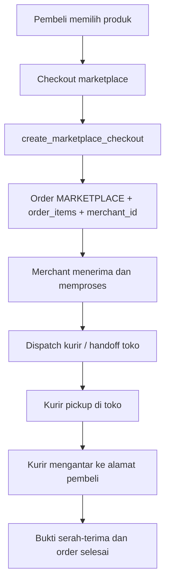
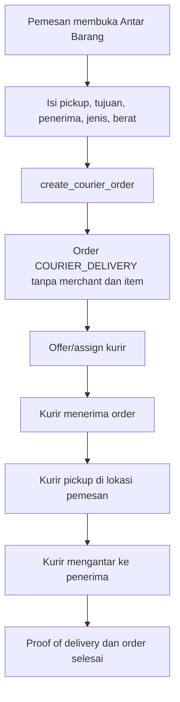

# Audit dan Rencana Perbaikan Dua Jenis Pengiriman

**Tanggal:** 18 September 2026  
**Repository:** `bonangpanjinur/Sadesa-fix`  
**Status:** Fondasi implementasi selesai; verifikasi staging database masih diperlukan.

## Kesimpulan

Aplikasi memiliki dua intent bisnis yang berbeda:

1. **Fulfillment pesanan toko.** Toko menerima pesanan produk, kurir mengambil barang dari toko, lalu mengantarkannya kepada pembeli.
2. **Antar barang langsung.** Pemesan biasa meminta kurir mengambil barang dari lokasi pickup dan mengantarkannya kepada penerima. Tidak ada merchant dan tidak ada item produk.

Keduanya sebaiknya **disatukan pada order platform, pembayaran, notifikasi, tracking, bukti serah-terima, dan riwayat**, tetapi **dipisahkan pada entry point, actor yang bertanggung jawab, data wajib, status operasional, chat, rating, dan laporan**. Pemisahan tersebut sekarang dikunci melalui `orders.service_type` serta kontrak frontend `src/lib/deliveryFlow.ts`.

## Temuan Audit

| Area | Pesanan toko | Antar barang langsung | Putusan |
|---|---|---|---|
| Identitas | `service_type = MARKETPLACE` | `service_type = COURIER_DELIVERY` | Pisahkan |
| Pickup | Toko/merchant | Pemesan atau lokasi yang dipilih pemesan | Pisahkan |
| Merchant | Wajib | Tidak ada | Pisahkan |
| Item produk | Ada pada `order_items` | Tidak boleh bergantung pada `order_items` | Pisahkan |
| Pengiriman | Salah satu tahap fulfillment | Inti layanan sejak order dibuat | Pisahkan lifecycle |
| Pembayaran, notifikasi, tracking | Platform order yang sama | Platform order yang sama | Satukan |
| Kurir | Mengambil dari toko | Mengambil dari pickup pemesan | Satukan actor, pisahkan konteks |
| Chat | Buyer–merchant dan buyer–kurir | Buyer–kurir | Pisahkan target |
| Riwayat | Toko, item, subtotal, ongkir | Pickup, tujuan, jenis barang, berat, biaya layanan | Pisahkan renderer |

Masalah risiko tinggi yang harus dihindari adalah mengklasifikasikan order kurir dari ketiadaan merchant saja. Data legacy boleh memakai fallback berbasis bentuk data, tetapi order baru harus selalu menulis `service_type` dari RPC authoritative. Migration `69_20260917180000_order_service_type.sql` sudah menyediakan kolom, backfill konservatif, constraint, dan index.

## Jalur 1 — Pesanan toko menggunakan jasa kurir

Data minimum adalah `merchant_id`, `order_items`, alamat pembeli, metode pembayaran, ongkir, dan status fulfillment. Status merchant seperti `NEW`, `PROCESSING`, `PROCESSED`, `SENT`, `DELIVERED`, dan `DONE` tidak boleh dipakai sebagai pengganti `service_type`.

## Jalur 2 — Orang biasa mengantar atau mengambil barang

Data minimum adalah pickup, tujuan, kontak penerima, jenis barang, berat opsional, catatan, jarak, biaya layanan, dan status dispatch. Jalur ini tidak boleh menampilkan nama toko, item produk, subtotal produk, tombol `Pesan Lagi`, atau chat merchant.

## Apa yang Disatukan

Kedua flow menggunakan `orders` sebagai aggregate transaksi. Keduanya dapat menggunakan payment status, cancellation policy, delivery proof, courier assignment, realtime order updates, notification routing, buyer tracking, dan history pagination. Penyatuan tersebut mengurangi duplikasi tanpa menghapus perbedaan bisnis.

Kontrak bersama berada di `src/lib/deliveryFlow.ts`. Kontrak tersebut memetakan `product` ke `merchant_fulfillment` dan `courier_delivery` ke `direct_courier`. Fallback service type kosong dianggap marketplace agar data legacy tidak berubah menjadi layanan kurir secara keliru.

## Apa yang Dipisahkan

Entry point harus tetap berbeda: marketplace masuk melalui `/checkout`, sedangkan pengiriman langsung masuk melalui `/transport/courier-booking`. Writer database juga berbeda: `create_marketplace_checkout` untuk order produk dan `create_courier_order` untuk order langsung.

Owner pickup harus berbeda. Pada marketplace, merchant menyiapkan barang. Pada direct courier, pemesan menyediakan lokasi pickup. Karena itu, operasi merchant, laporan penjualan, chat merchant, item produk, dan rating merchant tidak boleh diterapkan ke direct courier.

## Implementasi yang Diselesaikan

Perubahan yang dibuat pada audit ini adalah sebagai berikut:

- Menambahkan `src/lib/deliveryFlow.ts` sebagai kontrak tunggal untuk dua intent pengiriman.
- Menambahkan guard `isDirectCourierService` dan `isMarketplaceService`.
- Menambahkan test regresi `src/lib/deliveryFlow.test.ts` untuk service type, owner pickup, merchant requirement, item policy, dan fallback legacy.
- Memastikan implementasi existing memakai `service_type` eksplisit pada order buyer, detail, RPC booking kurir, state machine courier, dan cancellation.
- Menyediakan dokumen jalur operasional, keputusan penyatuan/pemisahan, dan acceptance criteria ini.

## Rencana Perbaikan Berikutnya

| Prioritas | Pekerjaan | Kriteria selesai |
|---|---|---|
| P0 | Terapkan seluruh bootstrap migration termasuk `69` dan migration courier setelahnya | `service_type` berconstraint di staging dan schema cache sudah reload |
| P0 | Uji dua create RPC dengan user buyer | Marketplace memiliki merchant/items; direct courier tidak memiliki merchant/items |
| P1 | Audit report, invoice, export, notifikasi, dan deep link | Direct courier tidak masuk omzet penjualan merchant |
| P1 | Uji RLS buyer, courier, merchant, dan admin | Setiap actor hanya membaca/mengubah konteks yang diizinkan |
| P1 | Uji status transition | Direct courier mengikuti courier state machine; marketplace mengikuti fulfillment state machine |
| P2 | Tambah metrik observability per `service_type` | Error dispatch, cancellation, completion, dan payout dapat dibandingkan |

## Checklist Verifikasi Staging

1. Buat checkout produk dengan pengiriman internal. Pastikan `service_type` adalah `MARKETPLACE`, `merchant_id` terisi, dan `order_items` terisi.
2. Buat order Antar Barang. Pastikan `service_type` adalah `COURIER_DELIVERY`, `merchant_id` kosong, dan tidak ada item produk.
3. Buka riwayat buyer. Pastikan order pertama berada pada konteks toko dan order kedua pada konteks **Ojek & Kurir**.
4. Buka detail direct courier. Pastikan yang muncul adalah pickup, tujuan, penerima, jenis barang, berat, biaya layanan, dan status kurir.
5. Pastikan direct courier tidak menampilkan chat merchant, subtotal produk, atau `Pesan Lagi`.
6. Terima offer sebagai kurir, lakukan pickup, delivery, upload proof, lalu selesaikan order.
7. Pastikan laporan merchant hanya menghitung order `MARKETPLACE` yang memiliki merchant terkait.
8. Ulangi uji untuk data legacy yang tidak memiliki `service_type` dan catat hasil backfill.

## Referensi Repository

- `supabase/bootstrap/53_20260911120000_courier_booking_dispatch.sql`
- `supabase/bootstrap/69_20260917180000_order_service_type.sql`
- `supabase/bootstrap/76_20260917203000_courier_delivery_state_machine.sql`
- `src/lib/buyerTransaction.ts`
- `src/pages/OrdersPage.tsx`
- `src/components/order/OrderDetailSheet.tsx`

## References

[1]: https://supabase.com/docs/guides/database/postgres/row-level-security "Supabase Row Level Security documentation"
[2]: https://developer.mozilla.org/en-US/docs/Web/HTTP/Reference/Headers/X-Frame-Options "MDN X-Frame-Options documentation"

## Update UI 18 September 2026

UI booking pengiriman langsung telah disederhanakan menjadi satu layanan bernama **Antar Barang**. Pilihan **Kirim barang** dan **Ambil barang** dihapus karena keduanya menggunakan operasi yang sama: kurir mengambil barang dari titik pickup dan mengantarkannya ke tujuan.

Form sekarang hanya meminta pickup, tujuan, penerima, detail barang, berat, catatan, jadwal, dan pembayaran. Field `mode` tidak lagi dikirim dari frontend karena RPC `create_courier_order` tidak memerlukannya untuk menentukan operasi. Kontrak backend tetap menggunakan `COURIER_DELIVERY` sehingga perubahan ini hanya menyederhanakan UX tanpa mengubah lifecycle dispatch.

Perubahan UI dilakukan pada `CourierBookingPage`, kartu navigasi `TransportServiceCards`, dan `TransportServicesPage`. Copy yang menjelaskan “kurir mengambil dari pickup lalu mengantar ke tujuan” tetap dipertahankan sebagai penjelasan alur, bukan sebagai pilihan layanan.
