# Flow Pembayaran QRIS Perusahaan sampai Withdraw Pedagang

Diagram ini menggambarkan model satu akun QRIS perusahaan untuk seluruh transaksi marketplace. Pembeli membayar ke perusahaan melalui QRIS dinamis/invoice. Setelah pembayaran tervalidasi oleh webhook, sistem membuat ledger pembagian dana merchant. Dana merchant baru dapat ditarik setelah order selesai dan melewati aturan settlement.

```mermaid
flowchart LR
    %% =========================
    %% BUYER / CHECKOUT
    %% =========================
    subgraph BUYER[PEMBELI]
        A[Melihat produk] --> B[Keranjang satu pedagang]
        B --> C[Checkout]
        C --> D[Isi alamat dan pilih pengiriman]
        D --> E[Server menghitung ulang harga, ongkir, voucher, total]
        E --> F{Pilih metode pembayaran}
    end

    F -->|QRIS / Bayar Online| G[Buat order\nstatus: PENDING_PAYMENT]
    F -->|Transfer manual| TM[Alur transfer manual\ndan review admin]
    TM --> G

    %% =========================
    %% PAYMENT PLATFORM
    %% =========================
    subgraph PAYMENT[PAYMENT GATEWAY DAN QRIS PERUSAHAAN]
        G --> H[Edge Function membuat invoice\ndan QRIS dinamis]
        H --> I[QRIS perusahaan\natas nama SaDesa]
        I --> J[Pembeli scan dan membayar]
        J --> K[Xendit menerima pembayaran]
        K --> L[Xendit mengirim webhook]
        L --> M{Validasi webhook}
        M -->|Token / invoice / nominal salah| MX[Tolak dan log untuk rekonsiliasi]
        M -->|Valid| N[RPC idempotent memproses pembayaran]
        N --> O{Status pembayaran}
        O -->|PAID| P[Order: PAID\nFulfillment dimulai]
        O -->|PENDING| Q[Tetap menunggu webhook]
        O -->|EXPIRED| R[Order tetap belum bayar\nInvoice dapat dibuat ulang]
        O -->|Duplikat| S[Idempotent: abaikan tanpa saldo ganda]
    end

    %% =========================
    %% PLATFORM LEDGER
    %% =========================
    subgraph LEDGER[LEDGER INTERNAL SADESA]
        P --> T[Buat payment transaction]
        T --> U[Hitung pembagian dana]
        U --> V[Catat merchant earning\nstatus: HELD]
        U --> W[Catat fee platform]
        U --> X[Catat ongkir / bagian kurir]
        V --> Y[Merchant dapat melihat saldo tertahan]
    end

    %% =========================
    %% FULFILLMENT
    %% =========================
    subgraph FULFILLMENT[PEMENUHAN PESANAN]
        P --> Z[Pedagang menerima pesanan]
        Z --> AA[Pedagang menyiapkan pesanan]
        AA --> AB[Kurir / pickup / pengiriman]
        AB --> AC[Pembeli menerima pesanan]
        AC --> AD{Ada komplain atau refund?}
        AD -->|Ya| AE[Review admin\ndan proses refund / penyesuaian]
        AD -->|Tidak| AF[Order selesai]
        AE --> AG{Keputusan admin}
        AG -->|Refund| AH[Kurangi / batalkan earning\ndan catat refund]
        AG -->|Lanjut settlement| AF
    end

    %% =========================
    %% SETTLEMENT
    %% =========================
    subgraph SETTLEMENT[SETTLEMENT PEDAGANG]
        AF --> AI[Release rule terpenuhi\norder selesai + masa komplain aman]
        AI --> AJ[Saldo merchant: AVAILABLE]
        AJ --> AK[Merchant melihat saldo tersedia]
        AK --> AL[Merchant mengajukan withdraw]
        AL --> AM[Validasi rekening, minimum withdraw,\ndan saldo tersedia]
        AM -->|Tidak valid| AN[Withdraw ditolak\ndan alasan ditampilkan]
        AM -->|Valid| AO[Buat withdrawal request\nstatus: PENDING]
        AO --> AP[Hold saldo agar tidak ditarik dua kali]
        AP --> AQ[Finance / admin review]
        AQ -->|Tolak| AR[Status: REJECTED\nSaldo dikembalikan]
        AQ -->|Setujui| AS[Transfer ke rekening merchant]
        AS --> AT{Transfer berhasil?}
        AT -->|Tidak| AU[Status: FAILED\nSaldo dikembalikan / retry aman]
        AT -->|Ya| AV[Catat bank reference\ndan waktu transfer]
        AV --> AW[Status: PAID\nSaldo merchant berkurang]
        AW --> AX[Merchant menerima dana]
    end

    %% =========================
    %% ADMIN / FINANCE
    %% =========================
    subgraph ADMIN[ADMIN / FINANCE]
        AY[Dashboard rekonsiliasi]
        AZ[Cocokkan invoice, webhook,\nledger, settlement, dan mutasi bank]
        BA[Laporan dana masuk,\nfee, earning, withdraw]
    end

    T -.-> AY
    AO -.-> AY
    AY --> AZ --> BA
    MX -.-> AY
    AH -.-> AY

    %% =========================
    %% STYLE
    %% =========================
    classDef buyer fill:#E8F1FF,stroke:#2563EB,color:#102A43
    classDef payment fill:#E8FFF3,stroke:#059669,color:#064E3B
    classDef ledger fill:#FFF7E6,stroke:#D97706,color:#78350F
    classDef fulfillment fill:#F3E8FF,stroke:#7C3AED,color:#4C1D95
    classDef settlement fill:#FFE8EF,stroke:#DB2777,color:#831843
    classDef admin fill:#EEF2F7,stroke:#475569,color:#1E293B
    class A,B,C,D,E,F buyer
    class G,H,I,J,K,L,M,N,O,P,Q,R,S payment
    class T,U,V,W,X,Y ledger
    class Z,AA,AB,AC,AD,AE,AF,AG,AH fulfillment
    class AI,AJ,AK,AL,AM,AN,AO,AP,AQ,AR,AS,AT,AU,AV,AW,AX settlement
    class AY,AZ,BA admin
```



## Ringkasan status saldo pedagang

```text
PAID order
   ↓
HELD       = pembayaran diterima, belum boleh ditarik
   ↓ order selesai dan masa komplain aman
AVAILABLE  = dapat diajukan withdraw
   ↓ withdraw dibuat
PENDING    = saldo di-hold, menunggu proses finance
   ↓ transfer berhasil
PAID       = dana sudah ditransfer ke rekening merchant
```

## Pembagian dana contoh

| Komponen | Nilai |
|---|---:|
| Harga barang | Rp100.000 |
| Ongkir | Rp10.000 |
| Biaya layanan platform | Rp2.000 |
| **Total dibayar pembeli** | **Rp112.000** |
| Earning pedagang | Rp100.000 |
| Bagian ongkir/kurir | Rp10.000 |
| Pendapatan SaDesa | Rp2.000 |

Seluruh Rp112.000 masuk ke akun QRIS/rekening perusahaan. Di dalam sistem, SaDesa wajib mencatat pemisahan tersebut sebagai ledger. Nominal yang boleh masuk ke saldo merchant bukan diambil dari input frontend, tetapi dihitung dari aturan server.

## Aturan withdraw yang disarankan

- Pedagang hanya dapat withdraw dari saldo `AVAILABLE`.
- Saldo `HELD` tidak dapat ditarik.
- Setiap permintaan withdraw memakai idempotency key.
- Saldo di-hold saat withdraw dibuat agar tidak terjadi double withdrawal.
- Minimum withdraw dapat ditetapkan, misalnya Rp50.000.
- Rekening tujuan harus sudah diverifikasi.
- Transfer yang berhasil wajib menyimpan `bank_reference`.
- Admin tidak boleh mengubah saldo langsung; gunakan RPC atau service transaction.
- Withdraw gagal harus mengembalikan saldo secara atomik.
- Semua perubahan dicatat dalam audit log dan dapat direkonsiliasi dengan mutasi bank.

## Catatan implementasi

Untuk tahap awal, transfer dari akun perusahaan ke pedagang dapat dilakukan manual oleh finance, kemudian admin mencatat nomor referensi transfer ke sistem. Otomatisasi payout dapat ditambahkan setelah ledger, refund, dan rekonsiliasi stabil.
