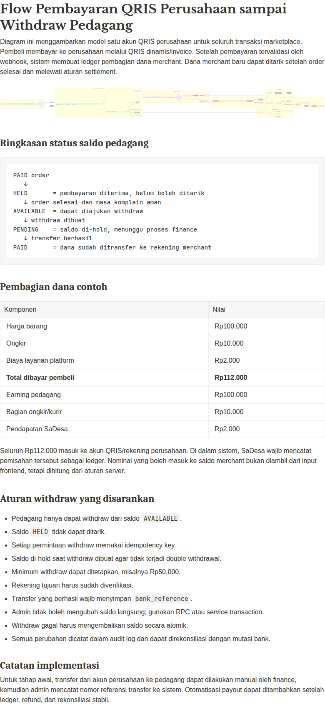

# Dokumentasi Pembayaran QRIS Perusahaan dan Withdraw Pedagang

**Produk:** SaDesa Marketplace
**Model pembayaran:** Satu akun QRIS/rekening perusahaan untuk seluruh transaksi
**Versi dokumen:** 1.0
**Status:** Rancangan operasional dan teknis
**Bahasa:** Indonesia

---

## 1. Tujuan

Dokumen ini menjelaskan cara pembayaran marketplace SaDesa bekerja ketika seluruh pembeli membayar ke satu QRIS milik perusahaan, serta bagaimana pendapatan pedagang dicatat, ditahan, tersedia untuk ditarik, dan akhirnya ditransfer ke rekening pedagang.

Dokumen ini menjadi acuan untuk:

- Product dan engineering ketika membangun fitur pembayaran.
- Admin dan finance ketika memproses settlement serta withdraw.
- Pedagang ketika memahami status pendapatannya.
- Support ketika menangani pembayaran tertunda, refund, atau withdraw gagal.
- Auditor ketika mencocokkan invoice, webhook, ledger, dan mutasi bank.

---

## 2. Ringkasan konsep

SaDesa menggunakan satu akun penerima milik perusahaan. Pembeli tidak membayar langsung ke rekening masing-masing pedagang.

```text
Pembeli
  ↓ membayar
QRIS / rekening perusahaan SaDesa
  ↓ dicatat di sistem
Ledger internal SaDesa
  ↓ setelah order selesai
Saldo tersedia pedagang
  ↓ setelah pedagang withdraw
Rekening pedagang
```

Walaupun akun penerimanya satu, sebaiknya setiap order menggunakan **QRIS dinamis atau invoice unik**. Dengan begitu, payment gateway dapat menghubungkan pembayaran dengan order tertentu secara otomatis.

> QRIS statis yang sama untuk semua order tidak disarankan sebagai alur utama karena sistem sulit menentukan pembayaran tersebut milik order yang mana.

---

## 3. Diagram alur utama



Versi sumber diagram tersedia di [flow pembayaran QRIS perusahaan sampai withdraw](../diagrams/flow-pembayaran-qris-perusahaan-sampai-withdraw.md).

---

## 4. Aktor dan tanggung jawab

| Aktor | Tanggung jawab |
|---|---|
| Pembeli | Membuat order, membayar, menerima pesanan, dan mengajukan komplain jika diperlukan. |
| Pedagang | Menerima dan menyiapkan pesanan, melengkapi rekening pencairan, melihat saldo, serta mengajukan withdraw. |
| Sistem SaDesa | Menghitung total, membuat invoice, menerima webhook, mencatat ledger, mengunci saldo, dan menjaga idempotency. |
| Admin operasional | Memantau order, menangani pengecualian, dan membantu penyelesaian masalah. |
| Finance | Mencocokkan dana masuk dan melakukan transfer withdraw ke pedagang. |
| Owner | Menyetujui kebijakan settlement, withdraw, dan tindakan keuangan penting. |
| Super admin | Mengelola konfigurasi tertinggi dan memiliki otorisasi penuh sesuai kebijakan internal. |
| Payment gateway | Membuat invoice/QRIS dinamis dan mengirim status transaksi melalui webhook. |

---

## 5. Alur detail pembayaran

### 5.1 Checkout

1. Pembeli memilih produk dari satu pedagang.
2. Pembeli mengisi alamat atau memilih pickup.
3. Sistem menghitung ulang:
   - harga produk;
   - jumlah dan stok;
   - voucher atau diskon;
   - ongkos kirim;
   - biaya layanan;
   - total akhir.
4. Sistem membuat order dengan status awal:
   - `order_status = PENDING_PAYMENT`;
   - `payment_status = UNPAID`.
5. Sistem menyimpan merchant, item, harga server, total, dan referensi checkout.

Nominal dari browser hanya digunakan sebagai tampilan. Nominal yang dikirim ke payment gateway harus berasal dari perhitungan server.

### 5.2 Membuat invoice atau QRIS dinamis

1. Frontend meminta pembuatan invoice menggunakan `order_id`.
2. Edge Function memvalidasi JWT dan kepemilikan order.
3. Edge Function memeriksa bahwa order belum dibayar atau dibatalkan.
4. Edge Function membaca total order dari database.
5. Edge Function membuat invoice ke payment gateway dengan:
   - `external_id = order_id`;
   - mata uang `IDR`;
   - total server;
   - expiry time;
   - URL sukses dan gagal.
6. Sistem menyimpan `invoice_id`, `invoice_url`, expiry, dan idempotency key.
7. Pembeli diarahkan ke halaman pembayaran gateway.

Jika invoice aktif sudah ada, sistem mengembalikan invoice tersebut dan tidak membuat invoice baru.

### 5.3 Pembeli membayar

Pembeli melakukan pembayaran melalui QRIS perusahaan atau kanal pembayaran lain yang disediakan invoice.

Redirect kembali ke SaDesa bukan bukti bahwa pembayaran berhasil. Halaman SaDesa wajib membaca status order dari database setelah kembali dari gateway.

### 5.4 Webhook pembayaran

Payment gateway mengirim webhook ke Edge Function. Handler webhook wajib:

1. Memeriksa callback token.
2. Memeriksa format invoice dan `external_id`.
3. Mencocokkan invoice dengan order.
4. Membandingkan nominal pembayaran dengan total order.
5. Menentukan event key untuk idempotency.
6. Memanggil RPC database dengan hak service role.
7. Mengubah status pembayaran secara atomik.
8. Mencatat event untuk audit dan rekonsiliasi.

Webhook yang sama dikirim ulang tidak boleh menggandakan order, earning, atau saldo pedagang.

---

## 6. Status order dan pembayaran

Status order dan status pembayaran harus dipisahkan. Pembayaran berhasil tidak selalu berarti pesanan sudah selesai.

### 6.1 Status pembayaran

| Status | Arti | Tindakan |
|---|---|---|
| `UNPAID` | Order belum memiliki pembayaran berhasil. | Buat invoice atau pilih transfer manual. |
| `PENDING` | Invoice dibuat, pembayaran belum dikonfirmasi. | Tunggu webhook. |
| `PAID` | Pembayaran sudah diverifikasi oleh webhook. | Pesanan boleh diproses. |
| `EXPIRED` | Invoice melewati masa berlaku. | Pembeli boleh membuat invoice baru. |
| `FAILED` | Pembayaran gagal atau bukti manual ditolak. | Tampilkan alasan dan izinkan retry sesuai aturan. |
| `REFUNDED` | Dana sudah dikembalikan atau telah direkonsiliasi. | Jangan membuat earning baru. |

### 6.2 Status pemenuhan order

| Status | Arti |
|---|---|
| `PENDING_PAYMENT` | Menunggu pembayaran. |
| `PROCESSING` | Pembayaran diterima dan pedagang menyiapkan order. |
| `READY` | Order siap diambil/dikirim. |
| `SHIPPED` | Order sudah dikirim. |
| `DELIVERED` | Order sudah diterima pembeli. |
| `DONE` | Order selesai dan dapat masuk aturan settlement. |
| `CANCELLED` | Order dibatalkan. |
| `DISPUTED` | Order sedang ditinjau karena komplain/sengketa. |

---

## 7. Pembagian dana internal

Semua dana masuk ke akun perusahaan, kemudian sistem membuat catatan pembagian internal.

### Contoh transaksi

| Komponen | Nilai |
|---|---:|
| Harga barang | Rp100.000 |
| Ongkos kirim | Rp10.000 |
| Biaya layanan SaDesa | Rp2.000 |
| **Total dibayar pembeli** | **Rp112.000** |
| Hak pedagang | Rp100.000 |
| Hak kurir/operasional pengiriman | Rp10.000 |
| Pendapatan SaDesa | Rp2.000 |

Pembagian ini harus dihitung server-side dan dicatat dalam ledger. Jangan menghitung saldo pedagang hanya dari total order di frontend.

### 7.1 Status earning pedagang

| Status | Arti |
|---|---|
| `HELD` | Pembayaran berhasil, tetapi dana masih ditahan sampai order aman untuk settlement. |
| `AVAILABLE` | Dana sudah dapat dipakai untuk withdraw. |
| `WITHDRAW_PENDING` | Pedagang mengajukan withdraw; dana sedang di-hold. |
| `PAID_OUT` | Transfer ke rekening pedagang berhasil. |
| `REFUNDED` | Earning dibatalkan karena refund atau keputusan sengketa. |
| `REVERSED` | Earning dikoreksi karena kesalahan rekonsiliasi atau pembatalan. |

---

## 8. Kapan dana pedagang menjadi tersedia

Dana tidak langsung menjadi `AVAILABLE` saat pembayaran masuk. Default yang disarankan:

```text
Pembayaran PAID
  ↓
Earning pedagang = HELD
  ↓
Order diterima pembeli dan status DONE
  ↓
Masa komplain berakhir
  ↓
Tidak ada dispute/refund aktif
  ↓
Earning pedagang = AVAILABLE
```

Durasi masa komplain ditentukan kebijakan bisnis. Nilainya harus berasal dari konfigurasi server dan ditampilkan jelas kepada pedagang.

Pengecualian dapat berlaku untuk pickup atau transaksi tertentu, tetapi harus didefinisikan sebagai aturan resmi dan tidak boleh diubah hanya dari browser.

---

## 9. Proses withdraw pedagang

### 9.1 Prasyarat

Pedagang hanya dapat membuat withdraw apabila:

- akun pedagang aktif;
- rekening pencairan sudah terdaftar dan diverifikasi;
- saldo `AVAILABLE` mencukupi;
- nominal memenuhi minimum withdraw;
- tidak ada blokir fraud atau sengketa yang berlaku;
- tidak ada withdraw aktif yang menggunakan saldo yang sama.

### 9.2 Langkah withdraw

1. Pedagang membuka halaman saldo.
2. Sistem menampilkan:
   - saldo `HELD`;
   - saldo `AVAILABLE`;
   - saldo sedang diproses;
   - total yang dapat ditarik.
3. Pedagang mengisi nominal withdraw.
4. Server memvalidasi nominal dan rekening tujuan.
5. Server membuat withdrawal request dengan status `PENDING`.
6. Saldo yang ditarik di-hold secara atomik.
7. Finance menerima antrean withdraw.
8. Finance memeriksa rekening tujuan dan ledger.
9. Finance melakukan transfer dari rekening perusahaan.
10. Finance menyimpan:
    - nama bank/e-wallet tujuan;
    - nominal aktual;
    - waktu transfer;
    - nomor referensi transfer;
    - bukti transfer jika kebijakan mengharuskan.
11. Sistem mengubah status menjadi `PAID_OUT`.
12. Pedagang menerima notifikasi dan dapat melihat riwayat withdraw.

### 9.3 Status withdrawal request

| Status | Arti |
|---|---|
| `PENDING` | Permintaan dibuat dan saldo sedang di-hold. |
| `PROCESSING` | Finance sedang melakukan verifikasi atau transfer. |
| `PAID_OUT` | Transfer berhasil dan referensinya tersimpan. |
| `REJECTED` | Permintaan ditolak; alasan wajib dicatat dan saldo dikembalikan. |
| `FAILED` | Transfer gagal; saldo dikembalikan atau masuk retry terkontrol. |
| `CANCELLED` | Permintaan dibatalkan sesuai aturan. |

### 9.4 Kegagalan transfer

Jika transfer gagal:

1. Jangan membuat withdrawal baru secara otomatis tanpa idempotency.
2. Tandai request `FAILED` atau `PROCESSING_REVIEW`.
3. Pastikan saldo dikembalikan tepat satu kali.
4. Simpan alasan kegagalan.
5. Finance memperbaiki rekening atau memilih retry.
6. Retry harus menggunakan request yang dapat dilacak, bukan membuat earning baru.

---

## 10. Rekonsiliasi finance

Finance melakukan rekonsiliasi pada tiga lapisan:

### 10.1 Rekonsiliasi pembayaran masuk

Cocokkan:

- invoice ID dari payment gateway;
- order ID SaDesa;
- nominal invoice;
- nominal dibayar;
- waktu pembayaran;
- status webhook;
- mutasi masuk rekening/akun QRIS perusahaan.

### 10.2 Rekonsiliasi ledger

Cocokkan:

- gross payment;
- hak pedagang;
- fee SaDesa;
- ongkos kirim atau bagian kurir;
- refund;
- koreksi;
- saldo `HELD` dan `AVAILABLE`.

### 10.3 Rekonsiliasi withdraw

Cocokkan:

- withdrawal request ID;
- merchant ID;
- nominal withdraw;
- rekening tujuan;
- waktu transfer;
- bank reference;
- mutasi keluar rekening perusahaan;
- status `PAID_OUT`.

Jumlah ledger harus dapat dijelaskan dengan formula:

```text
Saldo awal
+ earning baru
+ koreksi kredit
- refund
- withdraw berhasil
- koreksi debit
= saldo akhir
```

---

## 11. Refund, pembatalan, dan sengketa

### Sebelum pembayaran berhasil

Order dapat dibatalkan tanpa membuat refund karena belum ada dana terverifikasi.

### Setelah pembayaran berhasil tetapi sebelum settlement

Earning masih `HELD`. Jika refund disetujui:

1. Earning dibatalkan atau dikurangi.
2. Ledger refund dibuat.
3. Refund ditransfer melalui prosedur perusahaan.
4. Nomor referensi refund dicatat.
5. Order dan payment record diberi status `REFUNDED`.

### Setelah earning tersedia tetapi belum ditarik

Saldo `AVAILABLE` dikurangi melalui transaksi ledger refund. Jangan menghapus histori earning.

### Setelah withdraw berhasil

Refund harus diproses sebagai transaksi terpisah dan tidak boleh mengubah histori transfer yang sudah `PAID_OUT`. Jika saldo pedagang tidak mencukupi, kasus harus masuk review finance/admin.

---

## 12. Model data yang disarankan

Nama tabel dapat menyesuaikan schema yang sudah ada, tetapi minimal informasi berikut harus tersedia.

### `payment_transactions`

| Kolom | Fungsi |
|---|---|
| `id` | ID transaksi internal. |
| `order_id` | Referensi order. |
| `provider` | Contoh: `xendit`. |
| `invoice_id` | ID invoice provider. |
| `gross_amount` | Total yang dibayar pembeli. |
| `currency` | `IDR`. |
| `status` | Status pembayaran. |
| `paid_at` | Waktu pembayaran terverifikasi. |
| `provider_event_key` | Kunci idempotency webhook. |

### `merchant_earnings`

| Kolom | Fungsi |
|---|---|
| `id` | ID earning. |
| `order_id` | Order asal earning. |
| `merchant_id` | Pedagang penerima. |
| `gross_amount` | Hak kotor pedagang. |
| `platform_fee` | Fee SaDesa jika dipotong dari bagian pedagang. |
| `net_amount` | Nilai earning bersih. |
| `status` | `HELD`, `AVAILABLE`, `PAID_OUT`, dan lainnya. |
| `available_at` | Waktu earning boleh ditarik. |

### `merchant_withdrawals`

| Kolom | Fungsi |
|---|---|
| `id` | ID withdraw. |
| `merchant_id` | Pedagang pemohon. |
| `amount` | Nominal withdraw. |
| `destination_account_id` | Rekening tujuan yang sudah diverifikasi. |
| `status` | Status request. |
| `idempotency_key` | Mencegah withdraw ganda. |
| `processed_by` | Admin/finance yang memproses. |
| `bank_reference` | Nomor referensi transfer aktual. |
| `processed_at` | Waktu transfer. |
| `rejection_reason` | Alasan penolakan atau kegagalan. |

### `ledger_entries`

Ledger bersifat append-only untuk transaksi keuangan. Koreksi dilakukan dengan entry baru, bukan menghapus atau mengedit histori lama.

---

## 13. Keamanan dan kontrol teknis

1. Secret provider hanya disimpan di Supabase Edge Function Secrets.
2. Secret tidak boleh berada di `VITE_*`, browser, halaman admin, database yang dapat dibaca admin biasa, log, atau Git.
3. Semua perubahan pembayaran, earning, saldo, dan withdraw harus melalui RPC/Edge Function yang berotorisasi.
4. Nominal selalu divalidasi ulang di server.
5. Webhook wajib memiliki callback token dan idempotency.
6. Earning dan withdraw harus memakai row lock atau mekanisme atomic update.
7. Saldo tidak boleh diubah dengan operasi `UPDATE balance = ...` dari frontend.
8. Setiap withdraw harus mengurangi saldo tepat satu kali.
9. Semua perubahan penting mencatat actor, waktu, alasan, dan referensi transaksi.
10. QRIS/payment gateway dapat dinonaktifkan untuk invoice baru melalui kill switch, tetapi webhook transaksi lama tetap aktif.
11. Rekening pedagang tidak boleh diubah saat withdraw sedang `PENDING` atau `PROCESSING` tanpa prosedur verifikasi tambahan.

---

## 14. Hak akses Kas & Bank

Menu **Kas & Bank** mengandung data keuangan sensitif. Hak hapus harus dibatasi ketat.

### 14.1 Aturan penghapusan

Hanya role dengan otorisasi khusus yang boleh menghapus entry Kas & Bank, minimal:

- `super admin`;
- `owner`.

Admin operasional, finance biasa, pedagang, kurir, dan pembeli tidak boleh menghapus entry secara langsung.

### 14.2 Prinsip penghapusan

Untuk transaksi yang sudah berhubungan dengan pembayaran, settlement, withdraw, refund, atau mutasi bank, **hapus fisik sebaiknya tidak digunakan**. Gunakan:

- void;
- reversal;
- correction entry;
- soft delete dengan alasan dan audit trail.

Penghapusan fisik hanya boleh dilakukan untuk data yang memang salah input dan belum menjadi bagian dari rekonsiliasi, setelah otorisasi sesuai level role.

### 14.3 Kontrol yang wajib diterapkan

- Backend memeriksa role, bukan hanya menyembunyikan tombol di UI.
- Setiap delete/void menyimpan actor, timestamp, alasan, dan record sebelum perubahan.
- Entry yang sudah direkonsiliasi atau memiliki referensi bank tidak dapat dihapus langsung.
- Jika entry salah, buat entry pembalik yang mengacu pada entry asli.
- Penghapusan batch memerlukan konfirmasi tambahan dan audit.
- Semua tindakan delete/void dapat dilihat oleh owner/super admin.

### 14.4 Matriks akses sederhana

| Tindakan | Pembeli | Pedagang | Finance | Admin operasional | Owner | Super admin |
|---|---:|---:|---:|---:|---:|---:|
| Melihat data yang diizinkan | Tidak | Terbatas | Ya | Terbatas | Ya | Ya |
| Membuat catatan operasional | Tidak | Tidak | Ya | Sesuai izin | Ya | Ya |
| Memproses withdraw | Tidak | Tidak | Ya | Tidak | Ya | Ya |
| Menyetujui koreksi keuangan | Tidak | Tidak | Tidak | Tidak | Ya | Ya |
| Void/reversal | Tidak | Tidak | Sesuai delegasi | Tidak | Ya | Ya |
| Hapus entry Kas & Bank | Tidak | Tidak | Tidak | Tidak | Ya | Ya |
| Mengatur role dan izin | Tidak | Tidak | Tidak | Tidak | Terbatas | Ya |

---

## 15. Notifikasi pengguna

### Pembeli

- Pembayaran menunggu.
- Pembayaran berhasil.
- Invoice kedaluwarsa.
- Pembayaran gagal.
- Order diproses.
- Refund diproses atau selesai.

### Pedagang

- Order baru sudah dibayar.
- Earning masuk status `HELD`.
- Earning menjadi `AVAILABLE`.
- Withdraw dibuat.
- Withdraw sedang diproses.
- Withdraw berhasil.
- Withdraw ditolak atau gagal beserta alasannya.

### Finance/admin

- Webhook gagal diproses.
- Ada transaksi yang belum cocok dengan mutasi bank.
- Ada withdraw menunggu proses.
- Ada refund atau dispute.
- Ada settlement yang tidak dapat dibuat.

---

## 16. Skenario pengecualian

| Skenario | Penanganan |
|---|---|
| Pembeli kembali dari gateway tetapi webhook belum masuk | Tampilkan `Menunggu konfirmasi`; jangan tandai lunas dari redirect. |
| Webhook dikirim dua kali | Event kedua dianggap duplikat dan tidak menambah saldo. |
| Nominal webhook berbeda | Tolak, log, dan masuk rekonsiliasi manual. |
| Invoice kedaluwarsa | Tandai `EXPIRED`; izinkan invoice baru. |
| Transfer withdraw gagal | Tandai gagal, kembalikan saldo satu kali, dan simpan alasan. |
| Rekening merchant tidak valid | Tolak sebelum transfer; jangan mengurangi earning permanen. |
| Order refund setelah earning `HELD` | Batalkan earning dan proses refund. |
| Order refund setelah withdraw | Buat transaksi koreksi/refund terpisah dan minta review finance. |
| Sistem timeout saat membuat invoice | Gunakan idempotency key dan cek invoice existing sebelum retry. |
| Admin ingin menghapus transaksi | Gunakan void/reversal; hanya owner/super admin yang boleh menghapus entry yang memang memenuhi syarat. |

---

## 17. Checklist implementasi

### Pembayaran

- [ ] Satu akun QRIS/rekening perusahaan sudah ditentukan.
- [ ] Payment gateway mendukung invoice atau QRIS dinamis.
- [ ] `external_id` provider terhubung ke order ID.
- [ ] Nominal berasal dari perhitungan server.
- [ ] Webhook callback token aktif.
- [ ] Webhook idempotent dan tahan event tidak berurutan.
- [ ] Redirect tidak digunakan sebagai bukti pembayaran.

### Ledger

- [ ] Payment transaction dibuat saat webhook `PAID`.
- [ ] Earning pedagang dibuat tepat satu kali.
- [ ] Fee SaDesa dan bagian kurir tercatat terpisah.
- [ ] Earning memiliki status `HELD` dan `AVAILABLE`.
- [ ] Refund dan koreksi tidak menghapus histori.

### Withdraw

- [ ] Rekening pedagang diverifikasi.
- [ ] Minimum withdraw ditentukan.
- [ ] Saldo di-hold saat request dibuat.
- [ ] Withdraw memiliki idempotency key.
- [ ] Bank reference wajib dicatat setelah transfer.
- [ ] Withdraw gagal mengembalikan saldo dengan aman.
- [ ] Finance memiliki layar antrean withdraw.

### Kas & Bank

- [ ] Delete dibatasi ke owner dan super admin.
- [ ] Backend memvalidasi role.
- [ ] Entry tere-konsiliasi tidak dapat dihapus langsung.
- [ ] Void/reversal tersedia.
- [ ] Audit log delete/void tersedia.

### Go-live

- [ ] Uji staging selesai.
- [ ] Test nominal mismatch selesai.
- [ ] Test webhook duplikat selesai.
- [ ] Test invoice expired selesai.
- [ ] Test withdraw ganda selesai.
- [ ] Test refund dan reversal selesai.
- [ ] Prosedur rekonsiliasi finance disetujui.
- [ ] Kill switch dan prosedur rollback tersedia.

---

## 18. Kesimpulan

Model satu QRIS perusahaan dapat digunakan untuk marketplace SaDesa selama sistem tidak menganggap dana masuk sebagai saldo pedagang yang langsung dapat ditarik. Pembayaran harus masuk ke payment transaction, kemudian dibagi dalam ledger internal. Earning pedagang ditahan sampai order aman, lalu berubah menjadi `AVAILABLE`. Withdraw diproses melalui request terkontrol, saldo di-hold, transfer dilakukan oleh finance, dan hasil transfer dicatat dengan referensi bank.

Untuk menjaga integritas data keuangan, histori tidak dihapus sembarangan. Data Kas & Bank hanya dapat dihapus oleh `owner` atau `super admin` ketika benar-benar memenuhi syarat; transaksi finansial yang sudah direkonsiliasi harus dikoreksi melalui void, reversal, atau entry pembalik.
