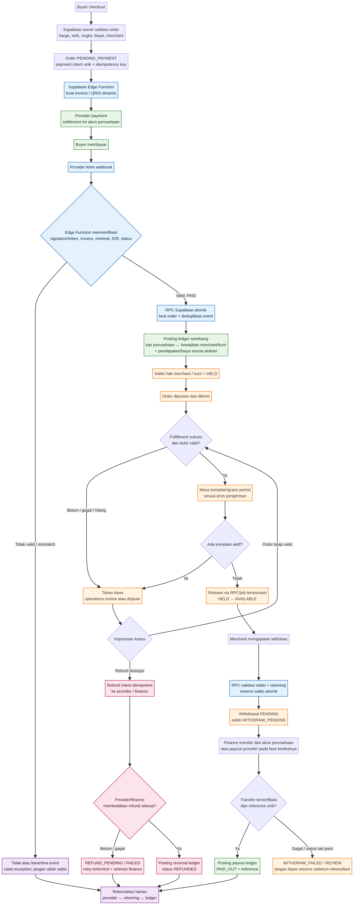

# Rancangan Pembayaran Terpusat Sadesa: Dana Perusahaan, Ledger, Refund, dan Withdraw

**Status:** rancangan untuk ditinjau sebelum implementasi  
**Tanggal:** 22 Oktober 2026  
**Cakupan awal:** checkout marketplace produk, alokasi hak merchant/kurir/platform, penahanan dana, refund, dan withdraw merchant.  
**Asumsi:** “dialurkan ke pembeli-pembeli” dimaknai sebagai alokasi hak dana kepada pedagang dan kurir. Jika yang dimaksud berbeda, pihak penerima perlu dikoreksi sebelum pembangunan.

## 1. Tujuan dan hasil yang diinginkan

Sadesa memakai satu jalur penerimaan untuk transaksi marketplace: pembeli membayar melalui QRIS dinamis atau invoice unik yang settlement-nya masuk ke rekening/saldo perusahaan Sadesa. Pembayaran tidak langsung dikirim ke rekening pedagang atau kurir.

Setelah provider mengonfirmasi pembayaran, server membuat catatan kewajiban internal per order. Bagian pedagang dan, bila relevan, bagian kurir dicatat sebagai dana tertahan. Dana baru dapat diajukan untuk withdraw setelah syarat pemenuhan pesanan dan masa komplain terpenuhi. Jika refund disetujui, Sadesa mengembalikan dana kepada pembeli dan mencatat pembalikan alokasi yang sesuai.

Tujuannya adalah membuat setiap rupiah dapat ditelusuri dari pembayaran pembeli sampai ke pembagian, refund, dan pencairan. Ini bukan janji bahwa seluruh uang selalu tersedia di saldo bank. Saldo kas/provider harus direkonsiliasi secara terpisah dari kewajiban pada ledger.

## 2. Batas cakupan

### Termasuk dalam tahap awal

- Satu akun penerimaan perusahaan untuk pembayaran marketplace produk.
- QRIS dinamis atau invoice unik per order; bukan QRIS statis bersama yang tidak mengidentifikasi order.
- Pembayaran online terverifikasi oleh callback/webhook provider.
- Pencatatan ledger per order untuk total dibayar, hak pedagang, ongkir/kurir, biaya platform, biaya provider, refund, reversal, dan withdraw.
- Status dana `HELD`, `AVAILABLE`, dan pencairan merchant.
- Refund dengan alasan, persetujuan, status eksekusi, dan bukti/nomor referensi.
- Antrean finance untuk withdraw manual sebagai tahap awal.
- Rekonsiliasi transaksi provider, ledger aplikasi, dan mutasi rekening.

### Tidak termasuk sampai dirancang dan disetujui terpisah

- Pembayaran marketplace jasa/escrow jasa, donasi, POS, top-up wallet komisi, dan order guest.
- Payout otomatis ke rekening banyak merchant/kurir melalui provider.
- Penyimpanan atau pengelolaan dana pihak ketiga di luar ketentuan provider dan aturan yang berlaku.
- Refund otomatis tanpa dasar state order, bukti pengiriman, kebijakan, atau proses sengketa.
- Multi-provider aktif bersamaan.

## 3. Prinsip arsitektur

1. **Satu penerima eksternal untuk transaksi marketplace.** QRIS/invoice perusahaan yang dipakai harus disediakan oleh provider/acquirer yang mendukung model bisnis marketplace dan settlement ke perusahaan. Jangan menganggap konfigurasi API atau dokumen produk otomatis mengizinkan model ini.
2. **Invoice unik untuk tiap order/payment attempt.** `order_id` dan reference provider harus dapat dicocokkan tanpa menebak berdasarkan jumlah atau waktu.
3. **Webhook adalah bukti status pembayaran.** Redirect browser hanya untuk navigasi. Browser tidak dapat mengatur nominal, status `PAID`, saldo, atau status refund.
4. **Kewajiban internal berbeda dari uang kas.** Ledger mencatat siapa yang berhak atas dana. Rekening perusahaan/provider menunjukkan kas yang benar-benar tersedia. Keduanya perlu rekonsiliasi.
5. **Ledger bersifat append-only.** Kesalahan diperbaiki dengan reversal/koreksi bertautan ke transaksi asal, bukan menghapus atau mengedit jurnal yang sudah dibukukan.
6. **Transisi finansial atomik dan idempotent.** Setiap event pembayaran, release, refund, serta withdraw memiliki kunci idempotensi; pengulangan tidak boleh menggandakan saldo atau transfer.
7. **Kustodi dan alur dana harus disetujui provider dan penasihat berwenang.** Di dokumen produk gunakan “dana tertahan/settlement tertunda” sebagai istilah operasional. Jangan menyebutnya escrow yang diatur/terjamin tanpa konfirmasi legal dan provider.

## 4. Alur pembayaran yang dirancang

```text
Checkout: server mengunci harga, stok, ongkir, biaya, dan penerima
        ↓
Order PENDING_PAYMENT + payment attempt unik
        ↓
Edge Function meminta QRIS dinamis/invoice kepada provider
        ↓
Pembeli membayar ke kanal perusahaan
        ↓
Provider webhook → verifikasi autentikasi, invoice, nominal, mata uang, status
        ↓
RPC transaksi atomik: payment PAID + event + jurnal pembagian + snapshot
        ↓
Hak merchant/kurir HELD; bagian platform/biaya dicatat sesuai kebijakan
        ↓
Pemenuhan order, bukti tiba, periode komplain
        ↓
Tidak ada sengketa → HELD menjadi AVAILABLE
        ↓
Merchant membuat withdrawal request → dana di-hold
        ↓
Finance transfer/payout → PAID_OUT + referensi bank/provider
```

Jika webhook tidak pernah tiba, order tidak boleh otomatis dianggap lunas dari tangkapan layar, redirect, atau klaim pengguna. Sediakan proses inquiry/reconciliation oleh server dan antrean pemeriksaan manual.

## 5. Perhitungan dan pembukuan per order

### 5.1 Snapshot checkout yang harus dikunci server

Sebelum pembuatan invoice, server menghitung dan menyimpan:

- item, jumlah, harga dan diskon yang berlaku;
- ongkir, jenis fulfillment, penyedia pengiriman, dan pihak yang menanggung ongkir;
- biaya layanan platform dan pajak/komponen lain jika berlaku;
- total yang harus dibayar pembeli;
- merchant penerima dan, bila diketahui, courier/provider pengiriman;
- formula dan versi kebijakan pembagian;
- mata uang IDR dan batas kedaluwarsa payment attempt.

Frontend hanya meminta `order_id` atau checkout reference. Nominal yang diberikan client tidak menjadi sumber kebenaran.

### 5.2 Contoh alokasi

Contoh ilustratif, bukan tarif final:

- Harga barang: Rp100.000
- Ongkir dibayar pembeli: Rp10.000
- Biaya layanan Sadesa: Rp2.000
- Total pembayaran: Rp112.000

Jika kurir internal berhak menerima seluruh ongkir dan provider fee ditanggung platform, jurnal konseptual setelah pembayaran adalah:

- Debit: kas/piutang settlement provider Rp112.000
- Kredit: kewajiban merchant Rp100.000
- Kredit: kewajiban kurir Rp10.000
- Kredit: pendapatan/biaya layanan Sadesa Rp2.000

Biaya provider harus dicatat terpisah sebagai biaya perusahaan atau dialokasikan sesuai kebijakan eksplisit. Jika pengiriman memakai ekspedisi pihak ketiga, ongkir tidak boleh otomatis dianggap sebagai saldo kurir Sadesa; buat payable/biaya ekspedisi sesuai kontrak. Semua jurnal harus seimbang dan nominal dalam satuan rupiah integer.

## 6. Model status

### 6.1 Status pembayaran

- `UNPAID`: belum ada pembayaran sukses.
- `PENDING`: invoice aktif menunggu pembayaran.
- `PAID`: provider telah mengonfirmasi pembayaran dan nilainya lolos validasi.
- `EXPIRED`: invoice kedaluwarsa tanpa pembayaran.
- `FAILED`: pembayaran ditolak atau gagal menurut provider.
- `PARTIALLY_REFUNDED`: sebagian dana berhasil dikembalikan.
- `REFUNDED`: refund penuh benar-benar tuntas.

Status pembayaran tidak menggantikan status pemenuhan order.

### 6.2 Status dana merchant/kurir

- `HELD`: hak internal sudah dibukukan, belum dapat ditarik.
- `AVAILABLE`: seluruh persyaratan release terpenuhi.
- `WITHDRAW_PENDING`: sejumlah saldo dicadangkan untuk permintaan withdraw yang sedang diproses.
- `PAID_OUT`: transfer berhasil dan referensi eksternal tercatat.
- `REVERSED`: kewajiban dibalik karena pembatalan/refund/koreksi; selalu bertaut ke jurnal asal.
- `DEBT/RECOVERY_REQUIRED`: refund atau koreksi melebihi dana yang belum dicairkan. Harus menjadi kasus finance, bukan saldo negatif tersembunyi.

Saldo diturunkan dari ledger dan reserve aktif. Jangan menyimpan saldo yang dapat dimutasi dari client.

### 6.3 Status refund

Pisahkan keputusan dari eksekusi:

- `REQUESTED` → `UNDER_REVIEW` → `APPROVED` atau `REJECTED`.
- Setelah `APPROVED`: `REFUND_PENDING` → `REFUNDED` atau `REFUND_FAILED`.
- Status `APPROVED` tidak boleh ditampilkan sebagai “uang sudah kembali”.
- Refund provider harus memiliki reference, amount, destination, event log, dan status final terverifikasi.

## 7. Kapan saldo dilepas

### Makanan/pengantaran lokal

Release tidak dilakukan saat merchant menandai “siap” atau saat kurir mengambil makanan. Dasar release minimal adalah bukti/status pengantaran yang diwajibkan (misalnya konfirmasi pembeli atau POD yang memenuhi standar), lalu masa komplain singkat yang dikonfigurasi per jenis layanan. Nilai menit/jam final diputuskan Product, Operations, dan Finance setelah mengukur SLA aktual.

Jika pembeli tidak merespons setelah POD valid, kebijakan dapat menyelesaikan order otomatis setelah grace period dan beberapa notifikasi, kecuali ada komplain aktif. Ini **bukan** auto-refund.

### Pesanan dengan ekspedisi

Gunakan status tracking provider dan bukti `delivered`, bukan timer tetap dari waktu checkout. Setelah status delivered yang sah, berikan masa komplain yang ditetapkan berdasarkan jenis barang dan layanan. Tracking macet, hilang, rusak, atau saling bertentangan masuk antrean pengecualian dan menahan dana.

### Merchant tidak merespons atau tidak mengirim

Batas waktu dihitung dari tahap yang tepat (misalnya batas menerima order atau batas serah ke kurir). Setelah lewat, backend dapat membatalkan order jika syaratnya terpenuhi dan memulai refund. Refund baru dianggap selesai setelah provider mengonfirmasi atau finance mencatat transfer manual terverifikasi.

### Aturan umum anti-release

Jangan release dana jika ada refund/dispute terbuka, status order tidak terminal sukses, proof-of-delivery tidak valid, fraud hold, payment mismatch, atau reconciliation exception yang belum ditangani.

## 8. Refund dan perlindungan pembeli

Refund harus menargetkan metode pembayaran asal jika provider mendukung dan kebijakan mengharuskannya. Jika refund provider tidak tersedia, tandai refund sebagai manual dan simpan tujuan, otorisasi, bukti transfer, reference, jumlah, dan pemeriksa. Jangan mengubah order ke `REFUNDED` sebelum pengembalian benar-benar selesai.

Saat refund disetujui:

1. Lock payment, order, dan jurnal terkait dalam transaksi database.
2. Pastikan jumlah yang dapat dikembalikan, refund sebelumnya, serta nilai yang sudah dicairkan.
3. Tandai kewajiban merchant/kurir sebagai reversal sesuai pembagian yang ditetapkan.
4. Buat refund intent dengan idempotency key, misalnya `refund:<refund_request_id>`.
5. Kirim permintaan refund melalui Edge Function/service yang server-only.
6. Verifikasi hasil provider melalui callback atau inquiry; callback sukses yang sama hanya diproses sekali.
7. Jika provider gagal/timeout, status tetap pending/failed dan masuk antrean retry/review. Jangan mencoba ulang permintaan non-idempotent secara buta.
8. Jika merchant sudah menerima payout, masukkan shortfall ke proses recovery/dispute yang disetujui; jangan mengurangi wallet komisi secara diam-diam.

Untuk pembatalan sebelum ada pembayaran, tandai payment attempt expired/cancelled dan tidak membuat refund transfer. Untuk pembayaran yang sudah sukses, pembatalan wajib masuk alur refund.

## 9. Withdraw merchant

Tahap awal disarankan menggunakan transfer manual oleh Finance melalui rekening perusahaan. Ini tetap merupakan withdraw yang dicatat sistem, bukan pembayaran otomatis.

### Persyaratan

- Profil merchant aktif dan identitas/rekening tujuan telah diverifikasi.
- Saldo `AVAILABLE` cukup; dana tidak sedang ditahan karena dispute, refund, fraud, atau koreksi.
- Ada minimum/maksimum, biaya, jadwal cut-off, dan SLA proses yang disetujui.
- Satu rupiah tidak dapat dipakai oleh dua request withdraw bersamaan.

### Siklus

1. Merchant meminta nominal withdraw dan memilih rekening terverifikasi.
2. RPC server memvalidasi pemilik, saldo, limit, dan status akun; membuat request serta reserve saldo secara atomik.
3. Finance melihat antrean dan melakukan pemeriksaan risiko/rekonsiliasi.
4. Transfer dilakukan dari rekening perusahaan.
5. Finance mencatat reference bank unik, nominal aktual, waktu, dan bukti yang diperlukan.
6. RPC menandai `PAID_OUT` dan membukukan jurnal transfer atomik.
7. Jika ditolak/gagal sebelum transfer, reserve dilepas satu kali. Jika status transfer tidak pasti, jangan melepas reserve sebelum mutasi diperiksa.

Jangan izinkan admin mengubah angka saldo langsung. Koreksi perlu jurnal adjustment dengan alasan, actor, approval sesuai batas nominal, dan audit trail.

## 10. Desain teknis yang disarankan untuk repository

Nama di bawah adalah usulan kontrak, bukan nama final. Ikuti konvensi migrasi/bootstrap dan keputusan skema repo sebelum membuat migration.

### Tabel/domain yang dibutuhkan

- `payment_intents`: order, provider, merchant account/company account reference, expected amount/currency, external reference, expiry, idempotency key, status.
- `payment_provider_events`: provider event ID, raw payload tersaring atau payload reference yang aman, verification result, processing status, occurred/received time; unik per provider event.
- `financial_ledger_entries`: transaksi/jurnal append-only; account key, debit/credit, source type/id, order, actor/system, idempotency key, reversal link, timestamp. Setiap journal group harus seimbang.
- `merchant_balance_accounts` / `beneficiary_balance_accounts`: identitas beneficiary saja; saldo dihitung dari ledger dan reserve. Jangan dicampur dengan `commission_wallets`.
- `withdrawal_requests`: beneficiary, verified payout destination snapshot, amount, status, reserve/journal IDs, external transfer reference, evidence, reviewer, failure/retry info.
- `refund_intents`: payment/order/request, amount, reason, destination policy, provider reference, status, idempotency key, approval and execution metadata.
- `fulfillment_milestones`: status yang dapat dipercaya, source (Sadesa/courier provider), timestamp, POD/tracking reference, dan hasil validasi.
- `reconciliation_runs` / `reconciliation_exceptions`: file/provider statement reference, matched entries, variance, owner, disposition, dan audit trail.

Simpan data pribadi rekening dengan akses minimum. Untuk event payload provider, simpan hanya data yang diperlukan, redaksi credential/PII pada log, dan tetapkan kebijakan retensi.

### RPC/transaksi server yang disarankan

- `reserve_payment_intent(order_id, attempt_key)` — memastikan order dan total snapshot valid; aman untuk retry.
- `process_payment_provider_event(event)` — dipanggil hanya backend setelah verifikasi signature/token; lock order/payment, cek invoice/status/nominal/currency, deduplikasi event, posting jurnal seimbang dan ubah status atomik.
- `release_held_earnings(order_id, policy_version)` — memeriksa fulfillment, dispute, fraud, refund, dan masa tunggu sebelum memindahkan payable dari held ke available.
- `request_withdrawal(amount, payout_destination_id)` — validasi ownership dan reserve saldo atomik.
- `complete_withdrawal(request_id, reference, amount, evidence)` — otorisasi Finance, reference unik, validasi nominal, posting payout.
- `request_refund(order_id, amount, reason)` / `decide_refund(...)` — state guard dan role separation.
- `complete_refund(refund_id, provider_result)` — idempotent, reference unik, nominal/status provider tervalidasi dan pembalikan jurnal.
- `post_manual_adjustment(...)` — role terbatas dan approval threshold; tidak boleh menjadi jalan pintas untuk menimpa ledger.

Hak tabel finansial harus default-deny untuk `anon` dan client `authenticated`. Perubahan dilakukan melalui Edge Function/service role atau RPC terkontrol. Tetapkan `search_path` aman, validasi role eksplisit, row lock untuk saldo/order, constraint unik idempotency/reference, dan batas akses RLS.

### Edge Functions/provider adapter

Pisahkan kontrak internal dari provider agar Xendit atau Neo dapat diganti tanpa merombak ledger:

- `create-payment`: autentikasi user, baca order server-side, pilih provider/channel yang disetujui, buat intent, panggil adapter, kembalikan QR/invoice URL saja.
- `payment-webhook`: tanpa JWT user bila provider membutuhkan callback publik, tetapi wajib verifikasi signature/token, timestamp/replay bila tersedia, serta invoice, nominal, mata uang, dan status.
- `create-refund` / `refund-webhook`: service-only; tidak boleh dipanggil browser untuk menentukan nilai/status.
- `payout` (opsional fase berikutnya): service-only, idempotent, menerima withdrawal ID alih-alih nominal bebas dari client.
- `reconciliation`: job terbatas yang mencocokkan invoice/provider settlement, ledger, dan mutasi bank/provider.

Semua private key, API key, callback secret, service-role key, dan private signing key harus berada di Supabase Function Secrets atau secret manager setara. Jangan menyimpan/memuatnya ke React, `VITE_*`, `app_settings` yang dapat dibaca UI, Git, atau log. Provider dipilih lewat config nonrahasia server-side yang aman; jangan percaya toggle frontend untuk mode live/test.

## 11. Pembagian kewenangan dan audit

- Buyer: membuat pembayaran, melihat statusnya, mengajukan refund/dispute.
- Merchant: melihat held/available, memenuhi order, mengajukan withdraw, tetapi tidak mengubah ledger atau status pembayaran.
- Courier: melihat imbalan dan status pengirimannya sesuai kebijakan; tidak mengubah saldo.
- Operations: menangani order dan bukti fulfillment.
- Finance: merekonsiliasi pembayaran, memproses transfer manual, dan meninjau exception.
- Admin/owner: menetapkan kebijakan dan menyetujui operasi berisiko sesuai limit; keputusan tidak menggantikan bukti transfer/provider.
- System/provider: menghasilkan payment/refund/payout events yang diverifikasi.

Operasi withdraw dan refund bernilai tinggi dapat memerlukan dual control (pembuat dan penyetuju berbeda). Log audit mencatat actor, action, object, old/new state yang aman, alasan, timestamp, dan correlation ID; jangan mencatat secret atau informasi kartu.

## 12. Rancangan laporan rekonsiliasi

Finance perlu dapat mencocokkan sekurangnya:

1. Order dan total yang ditetapkan server.
2. Payment intent serta invoice/reference provider.
3. Webhook/provider status, amount, currency, timestamps, dan event ID.
4. Settlement provider ke rekening perusahaan, termasuk fee/hold/settlement batch.
5. Jurnal merchant, courier/provider logistik, platform, dan biaya provider.
6. Refund yang diminta, disetujui, dibayar, atau gagal.
7. Withdrawal request, reserve, transfer bank, dan reference.
8. Saldo kas aktual versus payable internal yang masih held/available.

Selisih tidak boleh ditutup dengan update saldo langsung. Buat exception, tetapkan pemilik dan alasan, lalu posting koreksi yang dapat diaudit.

## 13. Tahapan pengerjaan

### Fase 0 — keputusan produk, provider, dan operasional

- Pilih provider utama (lanjutkan Xendit atau Neo/GDC) dan pastikan secara tertulis QRIS dinamis, settlement ke akun perusahaan, callback, inquiry, refund, settlement report, dan payout yang benar-benar tersedia pada akun/kontrak.
- Pastikan model marketplace dan pengelolaan dana sesuai kontrak provider serta minta telaah legal/finance mengenai custody, kewajiban pengembalian, pajak, dan perlindungan konsumen.
- Putuskan apakah checkout MVP mengizinkan satu merchant saja atau multi-merchant. Checkout repo saat ini menyebut asumsi single-merchant; jangan menjanjikan split multi-merchant sebelum parent/child order dan alokasi tiap merchant didesain.
- Tetapkan kebijakan fee, ongkir, pembatalan, masa komplain, SLA merchant/kurir/ekspedisi, minimum withdraw, refund parsial, dan dispute.

### Fase 1 — keamanan dan penerimaan pembayaran

- Perbaiki isu P1 yang tercatat dalam `docs/audits/audit-kesiapan-payment-gateway-xendit-2026-10-15.md`: credential server-only, rotasi key lama, pemisahan staging/production, dan uji callback.
- Tambahkan provider adapter dan payment intent QRIS/invoice perusahaan.
- Nonaktifkan/ubah jalur transfer manual yang mengarahkan pembeli ke QRIS/rekening merchant jika kebijakan satu pintu sudah disepakati. Pertahankan hanya sebagai jalur darurat yang jelas, jika disetujui.
- Uji pembayaran, expired, callback duplikat/tidak berurutan, nominal mismatch, timeout, dan inquiry/reconciliation.

### Fase 2 — ledger dan held balance

- Rancang akun/jurnal dan constraint balanced journal.
- Posting alokasi setelah payment verified.
- Implementasikan saldo held/available hasil ledger, bukan wallet komisi.
- Tambahkan reversal dan dispute hold.
- Uji race condition untuk callback dan perubahan fulfillment.

### Fase 3 — release dan refund

- Definisikan status fulfillment kanonik dan sumber bukti delivery.
- Implementasikan release job dengan konfigurasi SLA per delivery class; buat exception untuk tracking tidak valid.
- Implementasikan refund request/decision/execution terpisah, termasuk refund parsial dan kegagalan.
- Uji order batal sebelum bayar, sesudah bayar, tidak dikirim, delivered tetapi tidak dikonfirmasi, retur, dan dispute.

### Fase 4 — withdraw manual dan rekonsiliasi

- Implementasikan withdrawal request, reserve saldo, antrean finance, double approval sesuai limit, dan pencatatan reference/bukti.
- Buat laporan reconciliation serta operasional untuk transaksi selisih dan refund yang gagal.
- Uji withdraw ganda, gagal sebelum transfer, transfer status tidak pasti, reference duplikat, dan payout setelah dispute.

### Fase 5 — pilot dan kemungkinan payout otomatis

- Pilot pada staging dan sekelompok transaksi/merchant yang disetujui; cocokkan ledger dengan statement provider/bank setiap hari.
- Aktifkan produksi bertahap hanya setelah sign-off engineering, finance, operations, security, dan owner.
- Pertimbangkan payout API setelah withdrawal manual, ledger, recovery, limits, reconciliation, dan kontrol fraud terbukti stabil.

## 14. Kriteria penerimaan sebelum produksi

- Uang dari transaksi online marketplace settlement ke rekening/saldo perusahaan yang disetujui provider; bukti harus berasal dari konfigurasi provider dan statement, bukan klaim UI.
- Tidak ada jalur checkout aktif yang diam-diam menampilkan QRIS/rekening pribadi merchant bila produk berjanji satu pintu.
- Tidak ada rahasia provider yang dapat diterima browser/client.
- Webhook invalid, invoice salah, currency/amount mismatch, dan event duplikat ditolak atau diabaikan tanpa perubahan saldo ganda.
- Setiap pembayaran sukses menghasilkan tepat satu jurnal seimbang dan satu alokasi snapshot.
- Nilai held/available cocok dengan penjumlahan ledger dan reserves.
- Tidak ada release saat order disputed/refund pending/fulfillment tidak terbukti.
- Refund hanya dinyatakan selesai setelah provider atau finance membuktikan transfer; callback ulang aman.
- Withdraw mengunci saldo atomik, transfer tidak dapat diduplikasi, dan kegagalan tidak menghilangkan/menambah saldo.
- Finance dapat mengidentifikasi semua pembayaran yang belum settlement, webhook yang gagal, refund/withdraw pending, dan selisih kas-ledger.
- Uji RLS, role access, concurrency, idempotency, staging, backup, rollback, dan prosedur incident telah ditandatangani.

## 15. Keputusan terbuka yang wajib diselesaikan

1. Provider utama: Xendit atau Neo/GDC? Apakah akun aktual sudah mendapat fitur QRIS perusahaan, refund, serta settlement/payout yang dibutuhkan?
2. Apakah checkout hanya satu merchant per order pada MVP, atau harus mendukung keranjang banyak merchant sejak awal?
3. Siapa penerima ongkir: kurir Sadesa, ekspedisi, atau sebagian menjadi subsidi/biaya platform? Bagaimana bila pengiriman COD atau external courier?
4. Apakah saldo merchant baru available saat delivered, setelah pembeli konfirmasi, atau setelah grace period? Berapa grace period untuk makanan dan masing-masing tipe ekspedisi?
5. Bukti apa yang cukup untuk auto-complete jika pembeli tidak merespons? Bagaimana menangani POD yang diperselisihkan?
6. Apakah refund hanya kembali ke metode asal? Bagaimana penanganan refund parsial, saldo merchant yang sudah dicairkan, dan biaya provider non-refundable?
7. Withdraw manual atau payout API untuk MVP? Siapa yang menyetujui, berapa limit, dan bagaimana verifikasi rekening beneficiary?
8. Kebijakan legal, pajak, KYC/KYB, penyimpanan dana, dan komunikasi ke pengguna apa yang harus dipenuhi untuk model ini?

Jangan memulai migration produksi atau mengaktifkan pembayaran live sebelum keputusan di atas serta temuan kesiapan gateway diselesaikan.

## Referensi internal

- `docs/audits/audit-kesiapan-payment-gateway-xendit-2026-10-15.md`
- `docs/audits/audit-alur-refund-2026-09-18.md`
- `docs/operations/dokumentasi-pembayaran-qris-perusahaan-dan-withdraw-pedagang.md`
- `docs/operations/keterangan-flow-pembayaran-qris-dan-withdraw.md`
- `docs/plans/rencana-alur-payment-gateway-xendit.md`
- `src/pages/CheckoutPage.tsx`
- `supabase/functions/xendit-payment/index.ts`
- `supabase/functions/xendit-webhook/index.ts`
- `supabase/bootstrap/128_20261014230000_refund_manual_queue.sql`


## Diagram alur

Sumber Mermaid yang dapat diedit: [`flow-pembayaran-satu-pintu-sadesa.mmd`](../diagrams/flow-pembayaran-satu-pintu-sadesa.mmd). Preview PNG: [`flow-pembayaran-satu-pintu-sadesa.png`](../diagrams/rendered/flow-pembayaran-satu-pintu-sadesa.png).


